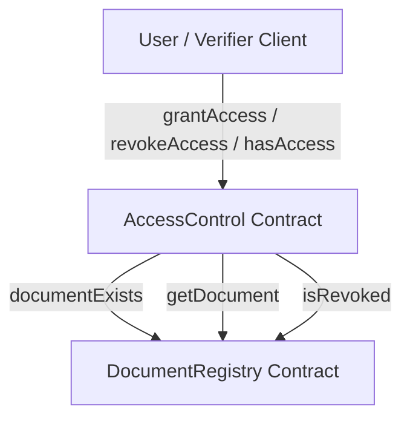
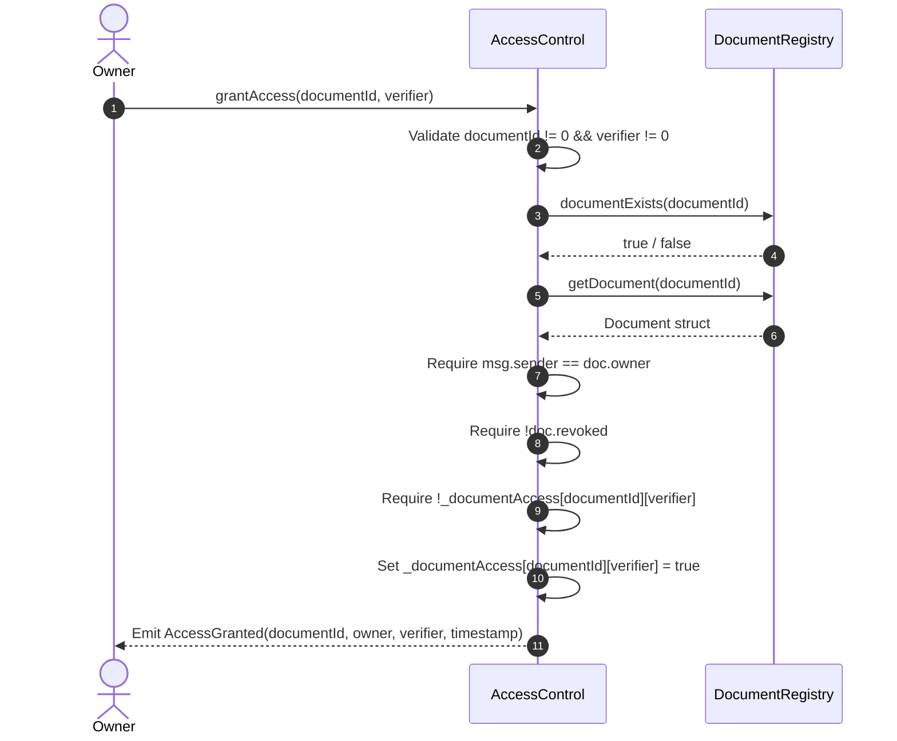
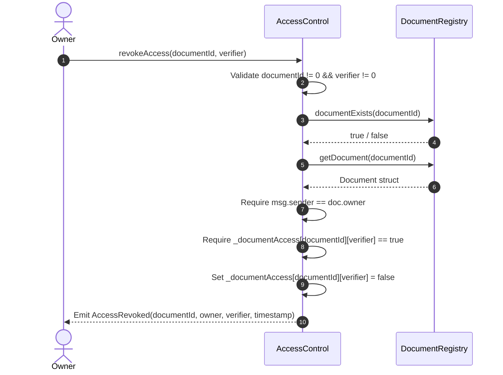

# AccessControl Smart Contract Technical Specification

## 1. Purpose of AccessControl

The `AccessControl` smart contract manages on-chain authorization for third-party verifiers, institutions, and recipient wallets seeking access to sovereign digital documents. 

In the Digital Document Locker architecture:
- **DocumentRegistry** is authoritative for document ownership, integrity proofs (SHA-256 hashes), decentralized storage pointers (IPFS CIDs), and document-level revocation.
- **AccessControl** is authoritative for granting, revoking, and querying document-specific verifier permissions.

AccessControl guarantees that only the authoritative document owner can modify permissions, and ensures that no address can access a document that has been revoked or that does not exist.

---

## 2. Relationship with DocumentRegistry

`AccessControl` maintains a strict, decoupled dependency on `DocumentRegistry` via the `IDocumentRegistry` interface:



### Dependency Invariants:
1. **Single Source of Truth for Ownership:** AccessControl never accepts a caller-specified owner parameter. It queries `documentRegistry.getDocument(documentId)` and enforces `msg.sender == doc.owner`.
2. **State Decoupling:** AccessControl does not re-store document hashes, CIDs, timestamps, or owner addresses.
3. **Immutable Contract Pointer:** The `documentRegistry` address is supplied during construction and stored in an immutable variable (`public immutable documentRegistry`), preventing redirect attacks.

---

## 3. Storage Model

To minimize gas costs and avoid unbounded array storage on-chain, `AccessControl` employs a sparse mapping:

```solidity
IDocumentRegistry public immutable documentRegistry;

// documentId => verifierAddress => isGranted
mapping(bytes32 => mapping(address => bool)) private _documentAccess;
```

- Key 1: `bytes32 documentId` (Unique 32-byte identifier).
- Key 2: `address verifier` (Ethereum wallet address of the verifier).
- Value: `bool` (`true` if granted, `false` otherwise).

Unbounded arrays of verifiers are deliberately avoided in contract storage; historical verifier grants and revocations are tracked off-chain through indexed blockchain events.

---

## 4. Permission Model

Permissions are strictly document-specific and verifier-specific:
- **No Wildcard Permissions:** There is no "grant to all" or wildcard address.
- **No Admin Overrides:** There is no administrative backdoor or contract owner role capable of overriding document permissions.
- **Cross-Document Isolation:** Permission granted for Document $A$ provides zero access to Document $B$.
- **Cross-Verifier Isolation:** Revoking permission for Verifier $1$ has zero impact on Verifier $2$.

---

## 5. Owner Authorization

Only the wallet address registered as the document owner in `DocumentRegistry` is authorized to grant or revoke access:

```solidity
IDocumentRegistry.Document memory doc = documentRegistry.getDocument(documentId);
if (msg.sender != doc.owner) {
    revert NotDocumentOwner(documentId, msg.sender);
}
```

Any call from a non-owner address reverts with `NotDocumentOwner(documentId, caller)` fail-closed.

---

## 6. Grant Flow



1. Caller invokes `grantAccess(documentId, verifier)`.
2. Validates inputs: non-zero `documentId`, non-zero `verifier`.
3. Verifies document exists in `DocumentRegistry`. Reverts with `DocumentNotFound` if absent.
4. Queries `DocumentRegistry` to retrieve owner and revocation status.
5. Verifies `msg.sender == doc.owner`. Reverts with `NotDocumentOwner` if unauthorized.
6. Verifies `!doc.revoked`. Reverts with `DocumentIsRevoked` if the document is revoked.
7. Verifies access has not already been granted. Reverts with `AccessAlreadyGranted` on duplicate grant.
8. Writes `_documentAccess[documentId][verifier] = true`.
9. Emits `AccessGranted` event.

---

## 7. Revoke Flow



1. Caller invokes `revokeAccess(documentId, verifier)`.
2. Validates inputs: non-zero `documentId`, non-zero `verifier`.
3. Verifies document exists in `DocumentRegistry`. Reverts with `DocumentNotFound` if absent.
4. Queries `DocumentRegistry` to verify `msg.sender == doc.owner`. Reverts with `NotDocumentOwner` if unauthorized.
5. Verifies access is currently active (`_documentAccess[documentId][verifier] == true`). Reverts with `AccessNotGranted` if not currently granted or already revoked.
6. Sets `_documentAccess[documentId][verifier] = false`.
7. Emits `AccessRevoked` event.

---

## 8. `hasAccess` Semantics

The `hasAccess(bytes32 documentId, address verifier)` view function computes **effective access**:

$$\text{hasAccess} \iff (\text{exists} \land \neg\text{revoked} \land \text{directGrant} \land \text{validInputs})$$

```solidity
function hasAccess(bytes32 documentId, address verifier) external view returns (bool) {
    if (documentId == bytes32(0) || verifier == address(0)) {
        return false;
    }
    if (!documentRegistry.documentExists(documentId)) {
        return false;
    }
    if (documentRegistry.isRevoked(documentId)) {
        return false;
    }
    return _documentAccess[documentId][verifier];
}
```

- Safe View Semantics: Does not revert on unknown or revoked documents; safely reports `false`.
- Transparency Helper: `isDirectAccessGranted(documentId, verifier)` is provided to query raw storage state for auditing purposes.

---

## 9. Document Revocation Interaction (Stale Permission Invariant)

When a document is revoked at the document level via `DocumentRegistry.revokeDocument(documentId)`:
1. `DocumentRegistry` sets `doc.revoked = true`.
2. The direct mapping entry in `AccessControl` may still record `true` (preserving historical record of the original grant).
3. Any call to `hasAccess(documentId, verifier)` **immediately returns false** because `documentRegistry.isRevoked(documentId)` returns `true`.
4. Any attempt to grant new permissions on the revoked document reverts with `DocumentIsRevoked`.

This guarantees that stale permissions can never bypass sovereign document revocation.

---

## 10. Events

Access control changes emit events with indexed topic filters:

```solidity
event AccessGranted(
    bytes32 indexed documentId,
    address indexed owner,
    address indexed verifier,
    uint256 timestamp
);

event AccessRevoked(
    bytes32 indexed documentId,
    address indexed owner,
    address indexed verifier,
    uint256 timestamp
);
```

- All three principal identifiers (`documentId`, `owner`, `verifier`) are indexed as topics, allowing efficient log queries via `eth_getLogs`.
- Timestamps are taken directly from `block.timestamp`.
- No sensitive data or encryption keys are emitted.

---

## 11. Validation Rules

| Input | Requirement | Failure Mode |
| :--- | :--- | :--- |
| `registryAddress` (Constructor) | `registryAddress != address(0)` | Revert `InvalidRegistryAddress()` |
| `documentId` | `documentId != bytes32(0)` | Revert `InvalidDocumentId()` |
| `verifier` | `verifier != address(0)` | Revert `InvalidVerifierAddress()` |
| Document Existence | `documentRegistry.documentExists(documentId)` | Revert `DocumentNotFound(documentId)` |
| Ownership | `msg.sender == doc.owner` | Revert `NotDocumentOwner(documentId, msg.sender)` |
| Document Revocation | `!doc.revoked` (on grant) | Revert `DocumentIsRevoked(documentId)` |
| Redundant Grant | `!_documentAccess[documentId][verifier]` | Revert `AccessAlreadyGranted(documentId, verifier)` |
| Redundant Revoke | `_documentAccess[documentId][verifier]` | Revert `AccessNotGranted(documentId, verifier)` |

---

## 12. Error Behavior

The contract utilizes custom Solidity errors for gas efficiency and precise revert decoding:

| Custom Error | Trigger Condition |
| :--- | :--- |
| `InvalidRegistryAddress()` | Deployed with `address(0)` as the registry address |
| `InvalidDocumentId()` | Called with `documentId == bytes32(0)` |
| `InvalidVerifierAddress()` | Called with `verifier == address(0)` |
| `DocumentNotFound(bytes32)` | Document ID does not exist in `DocumentRegistry` |
| `NotDocumentOwner(bytes32, address)` | Caller is not the recorded owner in `DocumentRegistry` |
| `DocumentIsRevoked(bytes32)` | Attempted to grant access to an already-revoked document |
| `AccessAlreadyGranted(bytes32, address)` | Attempted to grant access to an already-authorized verifier |
| `AccessNotGranted(bytes32, address)` | Attempted to revoke access from a verifier without an active grant |

---

## 13. Deployment Order

Deployment order is deterministic and strictly enforced:
1. **Step 1:** `DocumentRegistry` is deployed to the network.
2. **Step 2:** `DocumentRegistry` address is captured and written to deployment artifacts.
3. **Step 3:** `AccessControl` is deployed, providing the actual `DocumentRegistry` address to the constructor.
4. **Step 4:** Deployment script reads back `accessControl.documentRegistry()` and verifies it matches the actual address.

---

## 14. Contract Addresses & Local Deployment Summary

Deployments executed against the local Hardhat node (`http://127.0.0.1:8545`, Chain ID `31337`):

| Contract | Address | Transaction Hash | Block | Gas Used |
| :--- | :--- | :--- | :--- | :--- |
| **DocumentRegistry** | `0x5FbDB2315678afecb367f032d93F642f64180aa3` | `0x06ab2877e9867079b01d9246a4f9db30099d2ceac760c67d2999f792ce4f6851` | `1` | `629,314` |
| **AccessControl** | `0xe7f1725E7734CE288F8367e1Bb143E90bb3F0512` | `0x195d9759fdf11280b9d9a39de6f0d6210741467a224524d7011e6f06bf8cca5a` | `2` | `617,962` |

- **Deployer Address:** `0xf39Fd6e51aad88F6F4ce6aB8827279cffFb92266`
- **Artifacts:**
  - [DocumentRegistry.json](file:///Users/rajmishara/eman/blockchain/deployments/localhost/DocumentRegistry.json)
  - [AccessControl.json](file:///Users/rajmishara/eman/blockchain/deployments/localhost/AccessControl.json)

---

## 15. ABI / Artifact Generation

- **Compilation:** Solc `0.8.24` (evm target: `paris`).
- **Typechain:** Generated typed TypeScript contract wrappers in `blockchain/typechain-types/contracts/AccessControl.ts`.
- **JSON ABI:** Generated at `blockchain/artifacts/contracts/AccessControl.sol/AccessControl.json` and saved inside deployment record `blockchain/deployments/localhost/AccessControl.json`.

---

## 16. Security Decisions

1. **Read-Only External Dependency:** AccessControl performs only view calls (`documentExists`, `getDocument`, `isRevoked`) to `DocumentRegistry`. It executes no state-modifying cross-contract calls.
2. **Reentrancy Immunity:** Because the contract performs no Ether transfers and no untrusted external contract calls, reentrancy vulnerabilities are prevented by design without requiring non-reentrant mutex overhead.
3. **No Central Administrator:** There is no contract owner, admin role, or upgrade proxy that could arbitrarily grant access to user documents.

---

## 17. Deferred Functionality

In accordance with project phasing boundaries:
- **Phase 7:** Decentralized Identity Registry (`IdentityRegistry.sol`).
- **Phase 8:** Client-side AES-256-GCM envelope encryption and SHA-256 hash generation.
- **Phase 9:** Local IPFS daemon node integration and file pinning.
- **Phase 10:** Document REST API endpoints (`POST /api/documents/:id/share`, `POST /api/documents/:id/revoke-access`).
- **Phase 11:** Document sharing UI, verifier management dashboard, and audit visualization.
