# System Architecture & Data Flow
# Blockchain-Based Digital Document Locker

> **Document Status:** Frozen (Phase 2 Architecture Baseline)  
> **Document Version:** 1.0.0  
> **Phase Target:** Phase 2 of 16 (System Architecture & Data Flow)  
> **Governing Standards:** `ai_rules.md` (Non-Synthetic Data Policy), `MASTER_PLAN.md`, `PHASE_2_PROMPT.md`, `docs/requirements.md`

---

# 1. Architecture Overview

The **Blockchain-Based Digital Document Locker** is a decentralized, tamper-evident, sovereign digital document storage and verification system. Designed as an institutional-grade, zero-trust alternative to centralized repositories (such as the traditional DigiLocker), this platform integrates:
- **Decentralized Storage:** InterPlanetary File System (IPFS) for content-addressed distributed file persistence.
- **Client-Side Cryptography:** Deterministic SHA-256 hashing for file integrity and AES-256-GCM authenticated encryption for confidentiality.
- **Consensus-Driven State Machine:** Modular Ethereum smart contracts managing document registration, sovereign ownership, and granular access control.
- **Web3 Identity:** EIP-191 cryptographic signatures and Decentralized Identifier (`did:ethr`) identity bindings.
- **Immutable Auditability:** Native EVM event logs providing a transparent, append-only historical audit trail.

### High-Level System Architecture Diagram
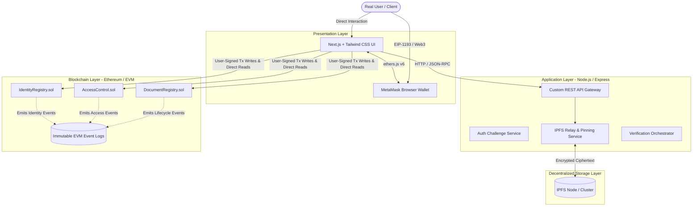

---

# 2. System Objectives

The architecture satisfies four primary system objectives:

1. **Absolute Data Integrity & Immediate Tamper Detection:**
   Every registered document is fingerprinted client-side with SHA-256 before encryption. The resulting digest is stored in Ethereum immutable storage. Any mutation of a single bit in a file changes its digest, triggering an immediate on-chain mismatch (`TAMPER DETECTED`).
2. **Strict Client-Side Confidentiality (Zero-Knowledge Storage):**
   Raw plaintext files never leave the client's browser unencrypted. Files are symmetrically encrypted using AES-256-GCM with a unique 256-bit key and 96-bit initialization vector (IV) per file. IPFS nodes and transport relays process only ciphertext.
3. **Sovereign Ownership & Decentralized Access Control:**
   Document owners possess exclusive authority to grant, query, or revoke access to their documents via smart contracts. Authorization decisions are enforced at EVM consensus, eliminating trusted administrative middlemen.
4. **Strict Real-Data Provenance & Zero Synthetic Fallbacks (`ai_rules.md`):**
   Every runtime value (addresses, hashes, CIDs, transaction receipts, block numbers, verification outcomes) is derived from authentic user actions, local Web Crypto computations, live IPFS node responses, or Ethereum provider calls. No mock, synthetic, or fallback data is permitted.

---

# 3. Layered Architecture

The system is decomposed into five distinct operational tiers:

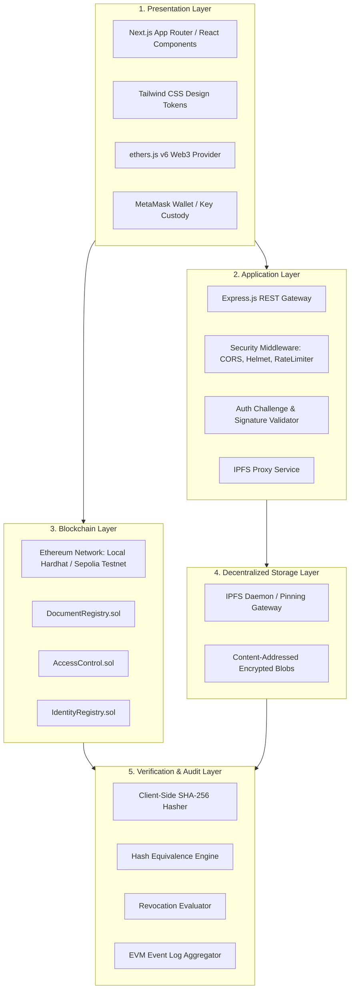

### Layer Responsibilities
- **1. Presentation Layer:** Renders the responsive UI, executes client-side cryptographic hashing and encryption (`window.crypto.subtle`), manages user wallet session state, requests MetaMask user signatures for state-changing transactions, and displays honest empty and error states.
- **2. Application Layer:** Provides auxiliary off-chain services: issues single-use cryptographic challenge nonces for session establishment, validates EIP-191 signatures, relays encrypted payloads to the IPFS daemon, and filters event logs for the audit UI.
- **3. Blockchain Layer:** The single source of truth for document ownership, immutable SHA-256 hashes, IPFS CIDs, access permissions, revocation flags, and chronological event logging.
- **4. Decentralized Storage Layer:** Highly available, peer-to-peer storage retaining encrypted document blobs pinned across network nodes.
- **5. Verification & Audit Layer:** Evaluates file validity in real time (< 2s) by comparing client-computed digests against on-chain records, checking revocation status, and reconstructing audit trails from on-chain event logs.

---

# 4. Component Architecture

The component architecture isolates domain responsibilities across frontend modules, backend micro-services, and smart contracts:

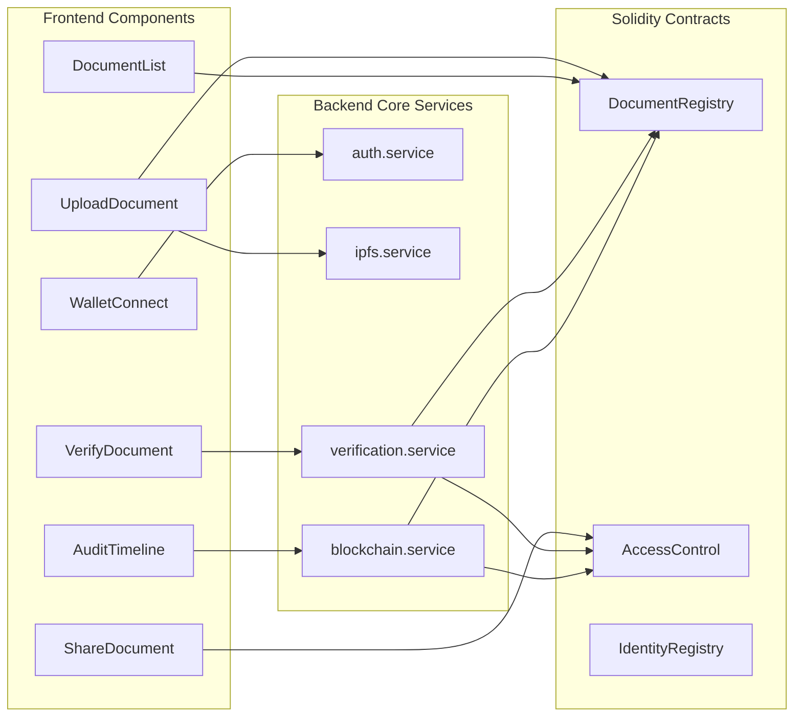

---

# 5. Frontend Architecture

The frontend is constructed using Next.js, Tailwind CSS, and `ethers.js` v6. It interfaces directly with MetaMask via standard EIP-1193 provider injection (`window.ethereum`).

### Component Inventory & Architectural Boundaries
The architecture defines the following minimum set of frontend components:

1. **`WalletConnect`:** Detects MetaMask extension, prompts user account access (`eth_requestAccounts`), tracks active account changes, and validates network Chain ID.
2. **`Authentication/Signature UI`:** Triggers `POST /api/auth/challenge`, presents challenge to user, requests EIP-191 `personal_sign` in MetaMask, and submits signature to `/api/auth/verify`.
3. **`Dashboard`:** Main container orchestrating views based on connection state, document loading, and user interactions.
4. **`DocumentList`:** Queries `DocumentRegistry` for the connected address and renders registered document entries.
5. **`DocumentCard`:** Displays single document metadata: ID, owner, CID link, timestamp, and active status badges.
6. **`UploadDocument`:** Accepts genuine user files (drag-and-drop or file selector) and passes binary bytes to hashing and encryption modules.
7. **`EncryptionStatus`:** Visual indicator displaying real-time cryptographic execution: SHA-256 calculation and AES-256-GCM symmetric key/IV generation.
8. **`UploadStatus`:** Visual indicator monitoring the progress of ciphertext payload transmission to the IPFS relay.
9. **`TransactionStatus`:** Live transaction tracker displaying pending submission, MetaMask prompt, broadcast hash, and mined block confirmation.
10. **`DocumentDetails`:** Expanded view providing granular document inspection, on-chain properties, and action buttons.
11. **`ShareDocument`:** Modal dialog permitting the document owner to enter an external verifier address and submit `AccessControl.grantAccess`.
12. **`AccessManagement`:** Table of currently authorized verifier addresses with controls to invoke `AccessControl.revokeAccess`.
13. **`VerifyDocument`:** Interface allowing users or verifiers to select an uploaded document to verify its cryptographic integrity.
14. **`VerificationResult`:** Real-time outcome visualizer showing **VERIFIED** (< 2s latency), **TAMPER DETECTED**, or **REVOKED ON-CHAIN**.
15. **`AuditTimeline`:** Chronological visualizer presenting historical lifecycle events queried from Ethereum event logs.
16. **`IdentityView`:** Displays the connected wallet's Decentralized Identifier (`did:ethr:<address>`) and registration status from `IdentityRegistry.sol`.
17. **`ErrorState`:** Fail-closed alert banners presenting honest error messages without synthetic fallbacks.
18. **`EmptyState`:** Clean empty-state views displaying honest notices such as *"No documents registered yet"* or *"No blockchain activity found"*.

---

# 6. Backend Architecture

The backend is organized as a modular Node.js/Express service written in TypeScript:

```text
backend/
└── src/
    ├── routes/             # REST route declarations
    ├── controllers/        # Request parsing and service invocation
    ├── services/           # External service integration and domain logic
    ├── middleware/         # Validation, rate limiting, and security controls
    └── server.ts           # HTTP server bootstrapping
```

### Component Responsibilities
- **Routes:** Expose application endpoints (`/api/auth`, `/api/ipfs`, `/api/documents`, `/api/verify`, `/api/audit`).
- **Controllers:** Translate HTTP request bodies, query params, and headers into service calls and serialize standard JSON responses.
- **Services:**
  - `auth.service.ts`: Generates single-use cryptographic challenge nonces with 5-minute TTL; verifies ECDSA signatures via `ethers.verifyMessage`; issues JWT session tokens.
  - `blockchain.service.ts`: Read-only `ethers.JsonRpcProvider` connection for contract state queries (`getDocument`, `hasAccess`) and event filter queries (`queryFilter`).
  - `ipfs.service.ts`: Streams client-encrypted ciphertext blobs to the IPFS daemon (`/api/v0/add`) and fetches pinned blocks by CID (`/api/v0/cat`).
  - `verification.service.ts`: Performs server-side verification comparison against on-chain contract state and benchmarks verification latency.
- **Middleware:**
  - Request schema validation (Zod / Joi).
  - Error normalization ensuring fail-closed responses.
  - JWT token verification and address extraction.
  - Security controls: Helmet HTTP headers, CORS whitelisting, and Express rate limiting.

---

# 7. Blockchain Architecture

The blockchain layer comprises three decoupled Solidity smart contracts compiled with `^0.8.20` or higher:

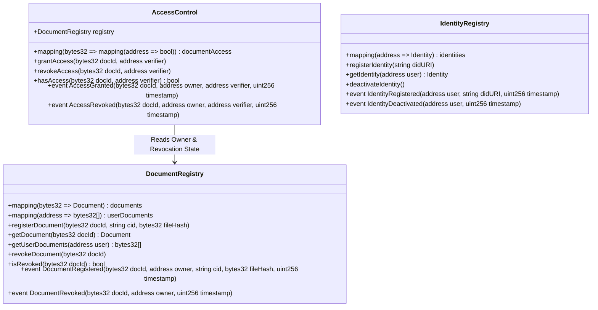

### Contract Responsibilities
- **`IdentityRegistry.sol`:**
  - Identity registration: Binds `msg.sender` to a W3C-compliant DID URI (`did:ethr:<address>`).
  - Identity retrieval: Returns DID metadata, registration timestamp, and active boolean.
  - Identity updates: Allows a user to update their associated DID URI.
  - Identity deactivation: Allows a user to deactivate their identity entry.
  - Wallet-to-identity association: Preserves 1-to-1 mapping between address and DID.
- **`DocumentRegistry.sol`:**
  - Document registration: Stores `id`, `owner` (`msg.sender`), `cid`, `fileHash`, and block `timestamp`.
  - Document retrieval: Returns document struct by `docId`.
  - Ownership: Enforces that registration records cannot be overwritten by other parties.
  - Document revocation: Restricts `revokeDocument` to `msg.sender == owner`, setting `revoked = true`.
- **`AccessControl.sol`:**
  - Document permissions: Maintains `documentAccess[docId][verifier]` mapping.
  - Grant access: Owner authorizes an external address (`grantAccess`).
  - Revoke access: Owner removes authorization (`revokeAccess`).
  - Access checks: `hasAccess` returns `true` if `verifier == owner` OR `documentAccess[docId][verifier] == true`, provided document is not revoked.
  - Owner authorization: Only the verified document owner can grant or revoke access.

---

# 8. IPFS Architecture

The InterPlanetary File System (IPFS) serves as the decentralized, content-addressed storage tier:

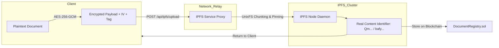

### Invariants & Ingestion Pipeline
- **Ciphertext Only:** Only AES-256-GCM encrypted payloads containing ciphertext, 12-byte IV, and 16-byte authentication tag are sent to IPFS.
- **Content Addressing:** Files are chunked according to UnixFS format, producing authentic Multihash Content Identifiers (CID v0 or v1).
- **Fail-Closed Upload:** If the IPFS daemon fails or is offline, upload terminates with an honest error. No CID is generated, and on-chain registration is halted.

---

# 9. Cryptography Architecture

The cryptographic subsystem enforces strict separation between data integrity and data confidentiality:

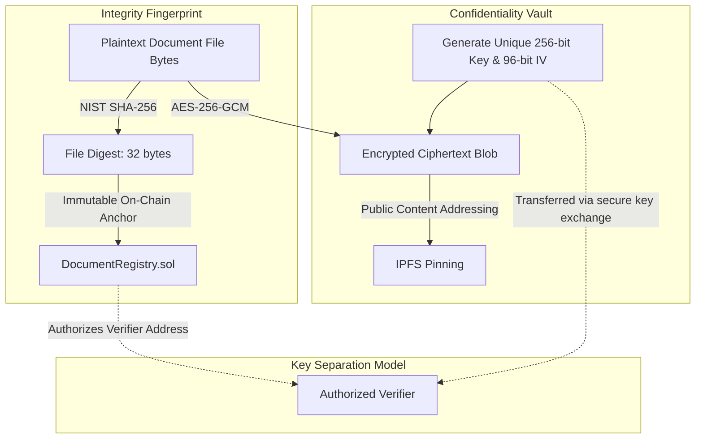

### Operational Separation
- **SHA-256 Hashing:** Computed client-side on raw unencrypted file bytes. Generates a 256-bit deterministic fingerprint stored on-chain for tamper detection.
- **AES-256-GCM Encryption:** Executed client-side with a unique 256-bit symmetric key and 96-bit IV per file. Produces ciphertext and a 128-bit authentication tag.
- **Key Separation:** Blockchain handles *authorization* (`hasAccess`). Cryptographic keys handle *decryption*. The raw symmetric key is **never** stored on-chain or published unencrypted to IPFS.

---

# 10. Identity / Wallet Architecture

Identity verification follows the Web3 Decentralized Identifier model anchored to user-held Ethereum private keys:

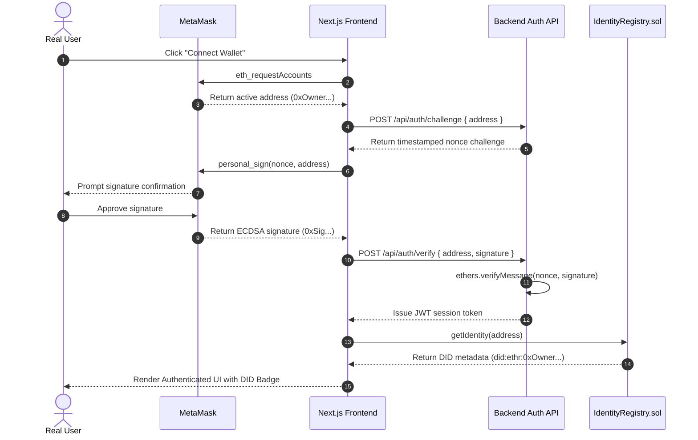

---

# 11. On-Chain vs Off-Chain Data

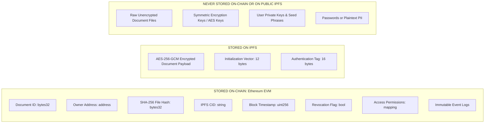

### Data Placement Policy
- **On-Chain:** Minimal metadata required for consensus, verification, and audit (Document ID, Owner, CID, SHA-256 Hash, Timestamps, Revocation, Access State, Events).
- **On IPFS:** Encrypted document ciphertext, initialization vector, and authentication tag.
- **Strictly Prohibited:** Raw PDF/document bytes, plaintext sensitive data, user private keys, seed phrases, raw encryption keys, or passwords.

---

# 12. Source-of-Truth Model

Every runtime value is derived from a single authoritative source:

```text
Wallet address      → MetaMask
Wallet signature    → MetaMask
Document bytes      → User upload
File hash           → Actual SHA-256 computation
Encrypted document  → Actual AES-256-GCM operation
IPFS CID            → Real IPFS response
Document owner      → DocumentRegistry
Document hash       → DocumentRegistry
Access permission   → AccessControl
Revocation          → Smart contract
Transaction status  → Blockchain receipt
Block               → Blockchain
Audit events        → Blockchain event logs
Verification result → Current hash + on-chain record + required state checks
Contract address    → Deployment output
Chain ID            → Blockchain provider
```

The UI must **never** treat local React state as authoritative for ownership, permissions, or verification outcomes.

---

# 13. Trust Boundaries

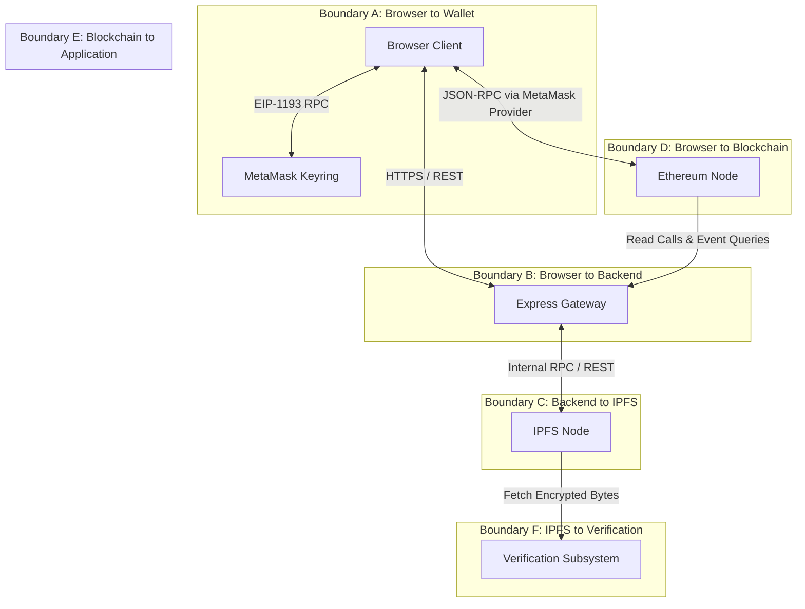

### Trust Boundary Definitions
- **Boundary A (Browser to Wallet):** The browser has no access to private keys; transactions require user approval in MetaMask.
- **Boundary B (Browser to Backend):** Backend treats all client inputs as untrusted and requires schema and signature validation.
- **Boundary C (Backend to IPFS):** Only encrypted payloads are sent; plaintext files are rejected.
- **Boundary D (Browser to Blockchain):** User-authorized transactions are signed directly through MetaMask.
- **Boundary E (Blockchain to Application):** Application reads real state/events and never fabricates on-chain data.
- **Boundary F (IPFS to Verification):** Retrieved content must be validated, decrypted if authorized, and hashed before verification.

---

# 14. Security Boundaries

Sensitive data containment boundaries:
- **Browser:** May contain current document bytes during upload, ephemeral cryptographic state, and public wallet address. Must NOT contain backend private keys, RPC private secrets, IPFS server secrets, or wallet seed phrases.
- **Backend:** May contain server-side environment variables (`.env`), IPFS connection tokens, and RPC endpoint credentials. Must NOT expose server secrets to the browser, and must NOT hold user private keys.
- **Blockchain:** May contain public wallet addresses, document hashes, CIDs, access booleans, and event data. Must NOT contain plaintext private documents, private keys, or raw encryption keys.
- **IPFS:** May contain AES-256-GCM encrypted document blobs. Must NOT receive unencrypted plaintext sensitive documents.

---

# 15. Data Flow

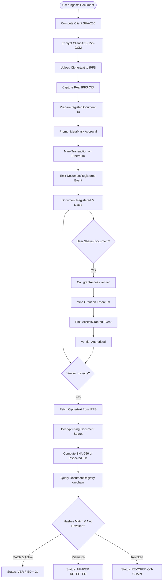

---

# 16. Upload/Registration Sequence

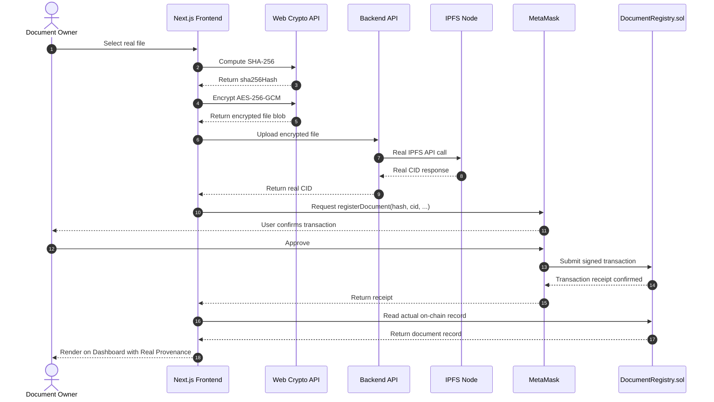

- **Fail-Closed Safeguards:**
  - If IPFS upload fails: No CID is generated, and on-chain registration must **not** proceed.
  - If the blockchain transaction fails or is rejected: The UI must **not** report registration success.
  - No CID or transaction hash may ever be fabricated.

---

# 17. Verification Sequence

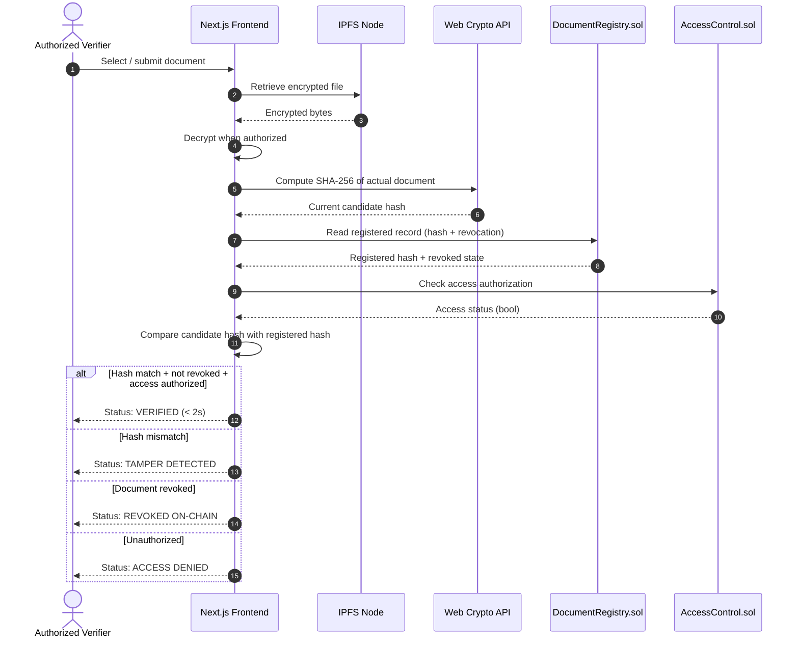

---

# 18. Sharing Sequence

```mermaid
sequenceDiagram
    autonumber
    actor Owner as Document Owner
    participant FE as Next.js Frontend
    participant MM as MetaMask
    participant Access as AccessControl.sol

    Owner->>FE: Input recipient address
    FE->>MM: Request grantAccess(recipient)
    MM-->>Owner: Prompt signature & gas approval
    Owner->>MM: Confirm transaction
    MM->>Access: Submit grantAccess tx
    Access->>Access: Require msg.sender == owner
    Access->>Access: Set documentAccess[docId][recipient] = true
    Access-->>MM: Emit AccessGranted event
    MM-->>FE: Transaction receipt confirmed
    FE-->>Owner: Display "Access Granted to Recipient"
```

The architecture explicitly distinguishes **blockchain authorization** from **cryptographic decryption capability**. Smart contract permissions authorize access; symmetric keys provide decryption.

---

# 19. Revocation Sequence

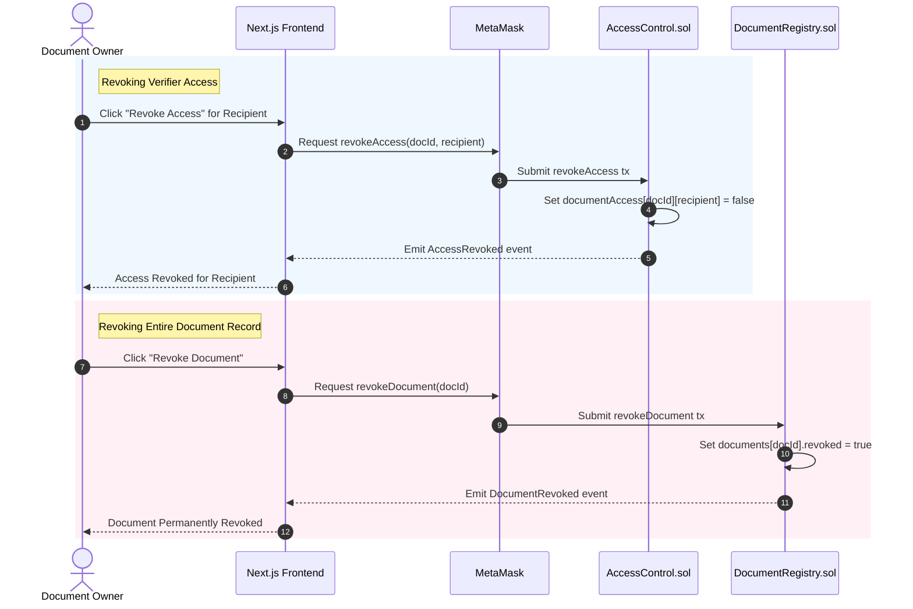

---

# 20. Audit Flow

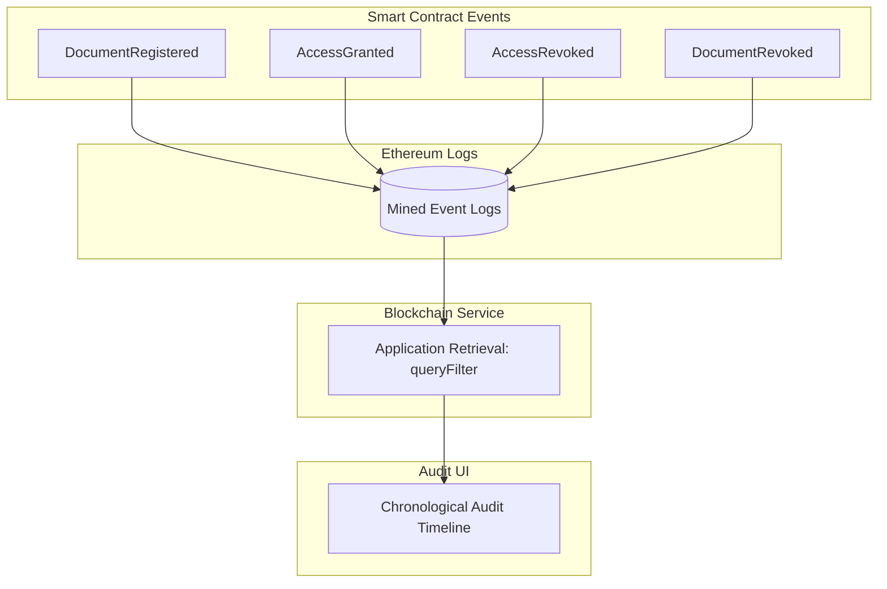

Audit records originate strictly from on-chain event logs. The system will **never** generate an audit record merely because a user clicked a button in the UI.

---

# 21. Error Flow

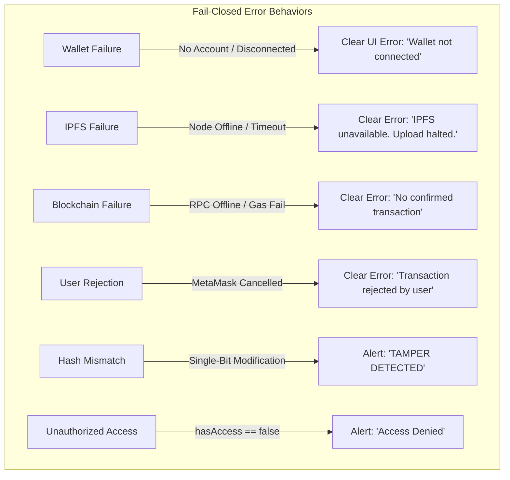

---

# 22. UI State Model

The frontend operates under 19 deterministic state categories:
1. `wallet disconnected`: Initial state before MetaMask injection or authorization.
2. `wallet connected`: Active account detected; ready for authentication challenge.
3. `authenticating`: Nonce challenge requested; awaiting MetaMask `personal_sign`.
4. `authenticated`: Valid signature verified; session established with DID badge.
5. `idle`: Main dashboard ready; awaiting user action.
6. `file selected`: User has selected a genuine document from local disk.
7. `hashing`: Computing client-side SHA-256 digest on raw file bytes.
8. `encrypting`: Generating 256-bit AES key/96-bit IV and producing ciphertext.
9. `IPFS upload pending`: Transmitting ciphertext payload to IPFS relay.
10. `IPFS uploaded`: Authentic CID received; preparing smart contract transaction.
11. `transaction pending`: MetaMask transaction submitted; awaiting block mining.
12. `transaction confirmed`: Transaction mined in block; receipt metadata parsed.
13. `verification pending`: Verifier file selected; querying on-chain record.
14. `verified`: Hash match confirmed, active, and access authorized (< 2s).
15. `tampered`: File hash mismatch detected; red warning rendered.
16. `revoked`: Document flagged as permanently revoked on-chain.
17. `unauthorized`: Wallet address lacks active smart-contract permission.
18. `service unavailable`: External RPC or IPFS service unreachable.
19. `empty state`: Clean zero-data notice (*"No documents registered yet"*).

---

# 23. Environment / Configuration Boundaries

```env
RPC_URL=
CHAIN_ID=

IPFS_API_URL=
IPFS_API_KEY=
IPFS_API_SECRET=

CONTRACT_ADDRESS=
CONTRACT_NETWORK=
```

### Configuration Governance
- **Backend Variables:** `IPFS_API_KEY`, `IPFS_API_SECRET`, and internal `RPC_URL` remain strictly server-side.
- **Frontend Safe Variables:** Public `CHAIN_ID`, public RPC gateway URL, and deployed `CONTRACT_ADDRESS` are safe for browser exposure.
- **Git Protection:** `.env` is ignored by Git via `.gitignore`.
- **Template Policy:** `.env.example` contains variable names only, without hardcoded values, ports, or default credentials.

---

# 24. Observability / Provenance

The system ensures complete operational transparency by surfacing authentic runtime provenance for every displayed value:

```text
File            → User upload
SHA-256         → Actual file computation
CID             → IPFS upload response
Owner           → MetaMask + smart contract
Transaction     → Blockchain receipt
Block           → Blockchain mined header
Permission      → AccessControl contract
Verification    → Actual comparison / state evaluation
```

### Observable Demonstration Artifacts
During review and demonstration, the application surfaces:
- Connected Chain ID (dynamically retrieved from active provider, matching environment configuration).
- Connected wallet address and DID.
- Deployed contract addresses.
- Transaction submission hash and confirmation status.
- Block number after transaction confirmation.
- Authentic IPFS CID (verifiable via gateway).
- Document SHA-256 fingerprint.
- Active on-chain access permissions.
- Document revocation state.
- Chronological blockchain audit events.
- Real-time verification latency timer (< 2.0s).

---

# 25. Architecture Decisions

The following architectural decisions are permanently frozen:

1. **Decision 1:** Blockchain is authoritative for ownership and blockchain state.
2. **Decision 2:** IPFS stores encrypted document content.
3. **Decision 3:** SHA-256 provides document-integrity hashing.
4. **Decision 4:** AES-256-GCM provides document encryption.
5. **Decision 5:** MetaMask provides user wallet authorization.
6. **Decision 6:** ethers.js provides EVM interaction.
7. **Decision 7:** Node.js/Express provides the custom application API layer.
8. **Decision 8:** Next.js provides the frontend framework.
9. **Decision 9:** User-authorized blockchain writes are signed through MetaMask.
10. **Decision 10:** No synthetic runtime/application data is permitted (`ai_rules.md`).
11. **Decision 11:** Failures must be reported honestly without fallback success states.
12. **Decision 12:** UI state must not replace blockchain truth.

---

# 26. Future Scope Boundaries

The following items are formally classified as **Future Scope** and excluded from the core implementation:
- **Mobile Native Applications:** iOS/Android standalone apps (Core focuses on responsive desktop/tablet Web3 browser interface).
- **FIDO2 / WebAuthn Biometrics:** Direct hardware-key WebAuthn bindings.
- **ZK-SNARK Implementations:**
  > *Clarification:* Standard SHA-256 hash comparison against a blockchain hash verifies integrity but is mathematically **NOT** a zero-knowledge proof. True ZK-SNARK circuits are deferred to future milestones.
- **Institutional B2B API Ecosystem:** Enterprise API integrations and third-party SaaS billing.
- **Cross-Chain Bridges:** Layer-2 bridges to Polygon or Arbitrum.
- **AI-Powered Fraud Detection:** Pre-upload anomaly detection models.

---

# 27. Architecture Diagrams Summary

The architecture includes the following 13 diagrams:
1. High-level architecture (§1)
2. Layered architecture (§3)
3. Component architecture (§4)
4. Decentralized storage / IPFS architecture (§8)
5. Cryptography & key separation architecture (§9)
6. Decentralized Identity / wallet authentication sequence (§10)
7. On-chain vs off-chain data placement (§11)
8. Multi-level trust boundaries (§13)
9. End-to-end data flow (§15)
10. Upload/registration sequence (§16)
11. Verification sequence (§17)
12. Sharing sequence (§18)
13. API interactions diagram (below)

### API Interactions Diagram
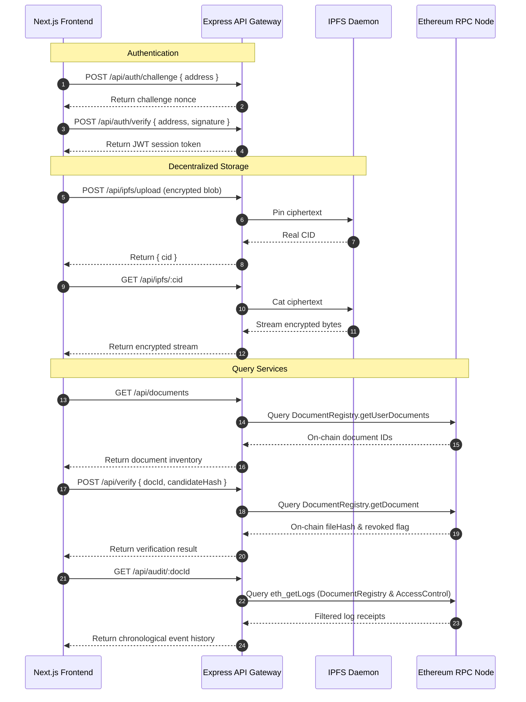

---

# 28. Phase 3 Blockchain Infrastructure Implementation

The Phase 3 milestone implements the underlying local blockchain infrastructure that supports all subsequent contract, authentication, and verification layers:

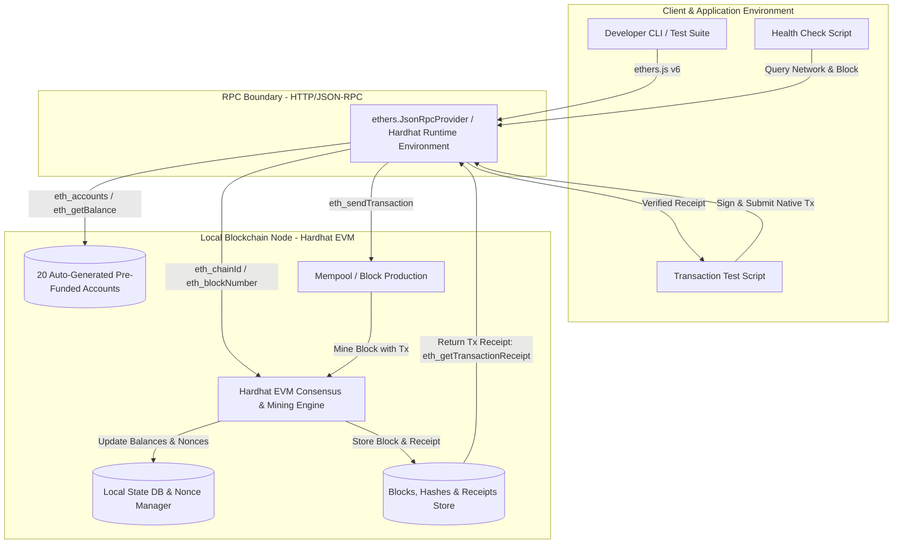

### Component Details

1. **Blockchain Node (`Hardhat EVM`):**
   - Implements local EVM state execution, block generation (instant automining), and state persistence during runtime.
   - Operates in standalone mode via `npx hardhat node` (listening on port `8545`) or in-process mode for automated test suites.
2. **RPC Boundary:**
   - Standard Ethereum JSON-RPC over HTTP (`http://127.0.0.1:8545`).
   - Abstracts network interaction so scripts and services communicate with the local node using the identical protocol later utilized for public testnets.
3. **Provider Layer:**
   - Implemented via `ethers.JsonRpcProvider` / Hardhat Runtime Environment (`hre.ethers.provider`).
   - Dynamically queries node state (`getNetwork`, `getBlockNumber`, `getBalance`) without cached or synthetic fallbacks.
4. **Development Accounts:**
   - Dynamic keypairs exposed by the local node (`await ethers.getSigners()`).
   - Zero hardcoding: Accounts and initial balances (10,000 ETH each) are retrieved dynamically at runtime.
5. **Transaction Path:**
   - Native account-to-account transfer (`sender.sendTransaction({ to, value })`).
   - Validates transaction submission, nonce incrementation, and transmission across the JSON-RPC boundary.
6. **Receipt Path:**
   - Explicit confirmation requirement via `await txResponse.wait(1)`.
   - Inspects real receipt metadata: `status` (1 = Success), `blockNumber`, `gasUsed`, `effectiveGasPrice`, and `hash`.
   - Validates mined block data (`getBlock(receipt.blockNumber)`) to confirm block hash, timestamp, and transaction inclusion.
7. **Network Health Path:**
   - Dedicated health-check script (`scripts/health-check.ts`) executing:
     - Connectivity check -> Chain ID validation -> Block height retrieval -> Account address retrieval -> Native balance check.
     - Fail-closed execution: Aborts with error if provider is unreachable or if `CHAIN_ID` mismatches configured environment.
8. **Public Testnet Boundary:**
   - Environment variables (`RPC_URL`, `CHAIN_ID`, `CONTRACT_NETWORK`) prepare the pipeline for future public testnets (e.g., Sepolia) without changing application call patterns.

