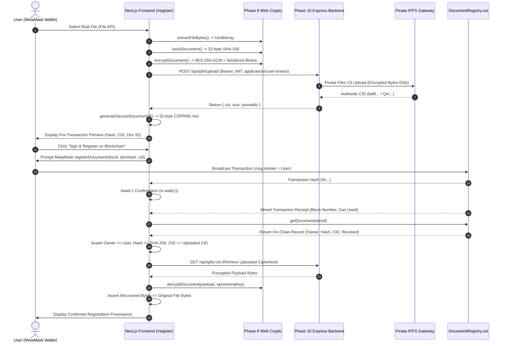

# Phase 12: Real End-to-End Document Registration Workflow

## 1. Executive Summary

Phase 12 implements the production-grade, end-to-end document registration workflow connecting the user's Web3 wallet (MetaMask), the Next.js frontend, the Phase 10 Express backend API, Phase 8 cryptography, Phase 9 decentralized IPFS storage (Pinata), and the on-chain `DocumentRegistry.sol` smart contract.

Strict architectural principles enforced:
1. **Real Runtime Data Only**: Zero synthetic, mock, fake, demo, or fallback application data. Every identity, document, permission status, verification score, CID, on-chain transaction status, and audit log originates from real runtime sources.
2. **Deterministic Cryptographic Pipeline**: Documents are hashed client-side using deterministic SHA-256, encrypted with authenticated AES-256-GCM using a cryptographically fresh 256-bit key and 96-bit IV, and serialized into the Phase 8 binary format before leaving the client.
3. **Decentralized Storage Isolation**: The encrypted payload is uploaded to live Pinata IPFS via the authenticated backend relay. The frontend never possesses Pinata credentials. Registration on-chain occurs if and only if an authentic CID has been confirmed.
4. **Non-Custodial Blockchain Execution**: The user signs the `DocumentRegistry.registerDocument(documentId, documentHash, ipfsCid)` transaction directly in MetaMask (`msg.sender == user wallet`). The backend holds zero private keys and never signs on behalf of the user.
5. **Post-Registration Verification**: Following transaction mining, the frontend immediately reads the on-chain record from `DocumentRegistry` to verify owner, hash, and CID, retrieves the encrypted payload from IPFS, and asserts byte-for-byte decryption fidelity with the original file.

---

## 2. End-to-End Registration Workflow



---

## 3. Detailed Component Specifications

### 3.1 Real File Input
- Accepts real browser `File` objects through HTML5 drag-and-drop or file picker (`<input type="file" />`).
- Extracts exact raw binary bytes into `Uint8Array` via `file.arrayBuffer()`.
- No mock blobs, fake files, or hardcoded byte buffers are used at runtime.
- Captures genuine file metadata (`fileName`, `fileSizeBytes`) for UI display only.

### 3.2 Pre-Upload Cryptographic Fingerprinting (SHA-256)
- Computes SHA-256 digest directly from the exact original plaintext bytes before encryption.
- Uses `frontend/lib/crypto/document-crypto.ts` (`hashDocument()`).
- Formats output as canonical `bytes32` (`0x`-prefixed 64 hex characters) matching `DocumentRegistry.sol` on-chain storage.
- File metadata, filenames, or ciphertext are never included in the primary document integrity hash.

### 3.3 Authenticated Client-Side Encryption (AES-256-GCM)
- Generates a fresh cryptographically random 256-bit AES key using Web Crypto CSPRNG (`crypto.getRandomValues(new Uint8Array(32))`).
- Generates a fresh cryptographically random 96-bit IV (12 bytes).
- Encrypts original file bytes using AES-256-GCM producing ciphertext and a 128-bit (16-byte) authentication tag.
- Serializes into the canonical Phase 8 binary format:
  ```text
  [1 byte Version: 0x01] [1 byte IV Length: 0x0c] [12 bytes IV] [Ciphertext + 16-byte Tag]
  ```

### 3.4 Key Handling & Isolation Invariants
- The AES-256 encryption key is strictly non-custodial:
  - NEVER sent to the blockchain or smart contract.
  - NEVER sent to IPFS or Pinata.
  - NEVER sent to backend API servers.
  - NEVER persisted to `localStorage` or `sessionStorage`.
  - NEVER logged or printed in DOM element text.
- The key is held in ephemeral React memory during the active session solely to execute the post-registration decryption verification.
- Users can optionally click "Download Key Backup (.key)" to download the raw key bytes directly to their disk via `URL.createObjectURL()`.

### 3.5 Decentralized IPFS Storage Upload
- Sends the serialized Phase 8 encrypted payload to the backend relay via `POST /api/ipfs/upload`.
- Requires an active Bearer JWT session.
- The backend validates that incoming payloads conform to the Phase 8 binary specification and forwards them to Pinata Files V3 API.
- If upload fails, the registration workflow halts immediately. No blockchain transaction is initiated, and no fallback CID is generated.

### 3.6 Authentic Content Identifier (CID) Handling
- Obtains authentic IPFS CID (CIDv1 base32 or CIDv0 base58) from the Pinata provider response.
- Validates format via `isValidCid()` (`/^Qm[1-9A-HJ-NP-Za-km-z]{44}$/` or `/^baf[a-z0-9]{40,100}$/i`).

### 3.7 Secure Document ID Generation
- Generated using a 256-bit CSPRNG source (`crypto.getRandomValues(new Uint8Array(32))`).
- Formatted as canonical `bytes32` (`0x`-prefixed 64 hex characters).
- Never derived from predictable inputs (filename, timestamp, counter, or user address).

### 3.8 MetaMask Transaction Submission
- Prompts MetaMask via ethers.js `BrowserProvider`:
  ```solidity
  DocumentRegistry.registerDocument(
      bytes32 documentId,
      bytes32 documentHash,
      string calldata ipfsCid
  )
  ```
- Ownership is bound irrevocably to `msg.sender` (the user's connected wallet address).
- Backend service holds zero private keys and cannot sign or broadcast registration transactions.

### 3.9 Transaction Confirmation & Provenance
- Waits for 1 real block confirmation (`tx.wait(1)`).
- Captures authoritative receipt data: `transactionHash`, `blockNumber`, `gasUsed`.
- Captures block timestamp and emits on-chain `DocumentRegistered` event.

### 3.10 Post-Registration Consistency & Decryption Verification
Immediately after transaction confirmation, the system runs an automated consistency suite:
1. **On-Chain Read**: Calls `DocumentRegistry.getDocument(documentId)`.
2. **Owner Assertion**: Asserts `chainRecord.owner.toLowerCase() === connectedWallet.toLowerCase()`.
3. **Hash Assertion**: Asserts `chainRecord.documentHash.toLowerCase() === computedHash.toLowerCase()`.
4. **CID Assertion**: Asserts `chainRecord.ipfsCid === authenticCid`.
5. **Revocation Assertion**: Asserts `chainRecord.revoked === false`.
6. **Decryption Roundtrip**: Downloads encrypted payload from IPFS via backend `GET /api/ipfs/:cid`, decrypts with local ephemeral key, and verifies byte-for-byte equality with original file bytes.
7. Any failure aborts the success state and displays an honest consistency alert.

---

## 4. Failure Path Handling

| Failure Scenario | Frontend Behavior | Blockchain / Storage State |
|---|---|---|
| **No Wallet Connected** | Blocks registration; displays prompt to connect MetaMask. | No action. |
| **Wrong Network** | Detects mismatch with `NEXT_PUBLIC_CHAIN_ID`; displays warning banner; disables submit button. | No action. |
| **Session Mismatch** | Validates `wallet.address === auth.address`. If mismatched, halts registration and requires re-authentication. | No action. |
| **IPFS Upload Failure** | Halts pipeline with `PREPARATION_FAILED`. Displays exact backend/IPFS error. | No transaction submitted. |
| **MetaMask Rejection** | Catches `ACTION_REJECTED` (code 4001). Transitions to `CANCELLED`. Informs user that the uploaded IPFS payload remains unreferenced. | Transaction not mined; contract untouched. |
| **Duplicate Document ID** | Smart contract reverts with `DocumentAlreadyExists(documentId)`. Caught and displayed as a clear revert error. | Transaction reverted; state preserved. |
| **Account Changed Mid-Flow** | Immediate session invalidation resets active registration state to prevent cross-account contamination. | In-flight registration halted. |
| **Post-Write Inconsistency** | If on-chain read does not match expected hash, CID, or owner, halts with consistency error. | Alert displayed to user. |

---

## 5. Orphan IPFS Objects Policy

When a user encrypts and pins an object to IPFS, but subsequently cancels or rejects the MetaMask transaction, the encrypted payload remains pinned on IPFS with an authentic CID.
- **Truthful Status**: The application honestly reports:
  *"Registration was cancelled in your wallet. The encrypted payload (CID: bafk...) was uploaded to IPFS prior to the transaction attempt and remains in unreferenced storage."*
- **Privacy Guarantee**: Because the payload was encrypted client-side via AES-256-GCM prior to transmission, unreferenced IPFS data contains zero plaintext and zero key material.

---

## 6. Document Metadata Scope

Phase 12 strictly records the authoritative on-chain fields defined in `DocumentRegistry.sol`:
- `documentId`: 32-byte unique identifier
- `owner`: Ethereum address of registrant (`msg.sender`)
- `documentHash`: 32-byte SHA-256 digest
- `ipfsCid`: IPFS Content Identifier string
- `registeredAt`: Unix block timestamp
- `revoked`: Boolean revocation flag

No synthetic metadata (arbitrary document titles, categories, tags, or issuer profiles) is fabricated or persisted.

---

## 7. Deferred Features

In accordance with project scope rules:
- **Phase 13**: Document sharing and access management (`AccessControl.grantAccess` and `AccessControl.revokeAccess`).
- **Phase 14**: Verification & tamper-detection workflow completion (standalone verifier decrypt-then-verify portal).
- **Phase 15**: Full system audit, gas optimization profiling, and final user documentation.
