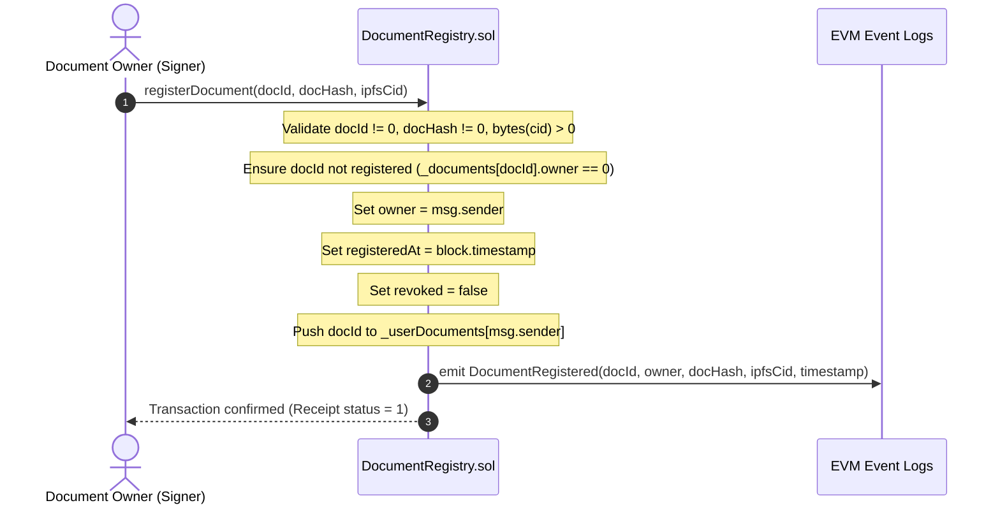

# DocumentRegistry Smart Contract Specification
# Blockchain-Based Digital Document Locker

> **Document Status:** Active (Phase 5 Implementation)  
> **Document Version:** 1.0.0  
> **Phase Target:** Phase 5 of 16 (DocumentRegistry Smart Contract)  
> **Governing Standards:** `ai_rules.md` (Non-Synthetic Data Policy), `MASTER_PLAN.md`, `PHASE_5_PROMPT.md`, `docs/requirements.md`, `docs/architecture.md`, `docs/security.md`

---

## 1. Contract Purpose

`DocumentRegistry.sol` is the authoritative, consensus-governed smart contract responsible for maintaining the permanent on-chain registry of sovereign digital documents within the Blockchain-Based Digital Document Locker ecosystem.

It provides immutable proof of document existence, cryptographic integrity anchors (SHA-256 digest), decentralized content addressing (IPFS CID), ownership attribution, block timestamping, and sovereign revocation controls.

---

## 2. Storage Model

The contract minimizes on-chain storage footprint while ensuring $O(1)$ lookups and complete historical auditability:

```solidity
struct Document {
    bytes32 documentId;   // Opaque 32-byte unique identifier
    address owner;        // Wallet address of document owner (msg.sender at registration)
    bytes32 documentHash; // 32-byte SHA-256 cryptographic digest of document bytes
    string ipfsCid;       // IPFS Content Identifier (CID v0 / v1)
    uint256 registeredAt; // EVM block timestamp of registration
    bool revoked;         // Revocation status flag
}
```

### Storage Mappings:
1. `mapping(bytes32 => Document) private _documents;`
   - Primary key-value mapping storing complete document records keyed by `documentId`.
2. `mapping(address => bytes32[]) private _userDocuments;`
   - Secondary index enabling owners to query all document IDs registered by their address.

---

## 3. Document ID Strategy

### 3.1 Design Decision: Opaque Cryptographic 32-Byte Identifier
The `documentId` is an opaque `bytes32` value generated cryptographically client-side before registration:
```typescript
const documentId = ethers.hexlify(ethers.randomBytes(32));
```

### 3.2 Invariants:
- **No Human-Readable Slugs:** Identifiers such as `doc1`, `passport-user`, or filenames are strictly prohibited to prevent namespace collisions, predictability, and metadata leakage.
- **Uniqueness Enforcement:** The contract enforces that `_documents[documentId].owner == address(0)`. Attempting to register an existing document ID reverts immediately with `DocumentAlreadyExists(documentId)`.
- **Zero Value Rejection:** `documentId == bytes32(0)` reverts with `InvalidDocumentId()`.

---

## 4. Hash Representation (Integrity Anchor)

- **Type:** `bytes32` (fixed 32-byte binary).
- **Digest Algorithm:** SHA-256 (NIST FIPS 180-4).
- **Architectural Boundary:** The contract does not compute the hash on-chain (which would require transmitting raw file bytes over the network at exorbitant gas costs). Instead, the client computes the SHA-256 digest over the plaintext file prior to encryption, and passes the 32-byte digest into `registerDocument`.
- **Validation:** `documentHash == bytes32(0)` reverts with `InvalidDocumentHash()`.

---

## 5. IPFS CID Representation (Storage Anchor)

- **Type:** `string` (UTF-8 string storing IPFS multihash, e.g., `bafybei...` or `Qm...`).
- **Architectural Boundary:** The contract stores the CID reference supplied by the caller. IPFS daemon relaying and pinning occur in Phase 9.
- **Validation:** Empty string (`bytes(ipfsCid).length == 0`) reverts with `InvalidIpfsCid()`.

---

## 6. Ownership Model

- **Sovereign Attribution:** The contract sets `doc.owner = msg.sender`.
- **Zero Caller Spoofing:** Callers cannot designate an arbitrary third-party address as the owner. The authentic signer of the Ethereum transaction becomes the exclusive owner.
- **Owner-Exclusive Authorization:** Only `msg.sender == doc.owner` is permitted to invoke state-modifying functions such as `revokeDocument`.

---

## 7. Registration Flow

### 7.1 Sequence


---

## 8. Lookup Flow

### 8.1 Read Functions
1. `getDocument(bytes32 documentId) external view returns (Document memory)`
   - Reverts with `DocumentNotFound(documentId)` if document does not exist.
   - Returns all stored fields: `documentId`, `owner`, `documentHash`, `ipfsCid`, `registeredAt`, `revoked`.
2. `getUserDocuments(address user) external view returns (bytes32[] memory)`
   - Returns array of document IDs registered by `user`. Returns empty array if none registered.
3. `documentExists(bytes32 documentId) external view returns (bool)`
   - Returns `true` if registered; `false` otherwise.
4. `isRevoked(bytes32 documentId) external view returns (bool)`
   - Returns `doc.revoked`. Reverts if document not found.

---

## 9. Revocation Flow

### 9.1 Revocation Semantics
Revocation represents an authoritative status transition, not data deletion:
- Once revoked, `doc.revoked = true` persists permanently.
- The historical hash, registration timestamp, and ownership records remain on-chain for tamper-evident auditability.
- Subsequent verification attempts in Phase 8 will inspect `isRevoked` and flag the document as **REVOKED ON-CHAIN**.

### 9.2 Guardrails
- Caller must be `doc.owner`; otherwise reverts with `NotDocumentOwner(documentId, msg.sender)`.
- If already revoked, reverts with `DocumentAlreadyRevoked(documentId)`.
- Emits `DocumentRevoked(documentId, msg.sender, block.timestamp)`.

---

## 10. Contract Events

```solidity
event DocumentRegistered(
    bytes32 indexed documentId,
    address indexed owner,
    bytes32 documentHash,
    string ipfsCid,
    uint256 timestamp
);

event DocumentRevoked(
    bytes32 indexed documentId,
    address indexed owner,
    uint256 timestamp
);
```
Both events index `documentId` and `owner` as topic filters, enabling instant log queries via `eth_getLogs` for the audit trail module (Phase 10).

---

## 11. Error & Revert Behavior

The contract utilizes custom Solidity errors for minimal bytecode size and maximum revert clarity:

| Custom Error | Trigger Condition |
| :--- | :--- |
| `InvalidDocumentId()` | `documentId == bytes32(0)` |
| `InvalidDocumentHash()` | `documentHash == bytes32(0)` |
| `InvalidIpfsCid()` | `bytes(ipfsCid).length == 0` |
| `DocumentAlreadyExists(bytes32)` | `_documents[documentId].owner != address(0)` |
| `DocumentNotFound(bytes32)` | Queried document ID does not exist in storage |
| `NotDocumentOwner(bytes32, address)` | Non-owner attempts to execute `revokeDocument` |
| `DocumentAlreadyRevoked(bytes32)` | Owner attempts to revoke a document that is already revoked |

---

## 12. Local Deployment & Artifacts

- **Deployment Script:** [blockchain/scripts/deploy-document-registry.ts](file:///Users/rajmishara/eman/blockchain/scripts/deploy-document-registry.ts)
- **Deployment Artifact:** `blockchain/deployments/localhost/DocumentRegistry.json`
- **Stored Artifact Fields:**
  - `contractName`: `"DocumentRegistry"`
  - `address`: Actual deployed Ethereum contract address (`0x...`)
  - `transactionHash`: Deployment transaction hash
  - `blockNumber`: Block number containing contract creation
  - `chainId`: Network Chain ID (`31337`)
  - `deployer`: Deployer wallet address
  - `deployedAt`: ISO timestamp
  - `abi`: Complete contract Application Binary Interface (JSON)

### Local Verified Deployment Summary

| Field | Value |
| :--- | :--- |
| **Contract Name** | `DocumentRegistry` |
| **Contract Address** | `0x5FbDB2315678afecb367f032d93F642f64180aa3` |
| **Chain ID** | `31337` (Hardhat Localhost) |
| **Deployer Address** | `0xf39Fd6e51aad88F6F4ce6aB8827279cffFb92266` |
| **Deployment Tx Hash** | `0x06ab2877e9867079b01d9246a4f9db30099d2ceac760c67d2999f792ce4f6851` |
| **Deployment Block** | `1` |
| **Gas Used** | `629,314` |
| **Artifact Path** | [DocumentRegistry.json](file:///Users/rajmishara/eman/blockchain/deployments/localhost/DocumentRegistry.json) |

---

## 13. Security Decisions & Immutability Invariants

1. **Arithmetic Safety:** Compiled with Solidity `0.8.24` with default built-in overflow/underflow checking.
2. **Reentrancy Immunity:** `DocumentRegistry` performs zero external calls or ETH value transfers; reentrancy guards are omitted to avoid useless gas overhead.
3. **Immutability of Core Fields:** No function exists to overwrite `documentHash`, `ipfsCid`, or `owner` post-registration. The registration is an unalterable historical proof.
4. **Zero Secret Storage:** Plaintext files, AES symmetric keys, and private credentials are never stored on-chain.

---

## 14. Deferral to Later Phases

- Verifier access grant/revoke permissions (`AccessControl.sol`) -> **Phase 6**
- Decentralized Identity registry (`IdentityRegistry.sol`) -> **Phase 7**
- Client-side AES-256-GCM encryption & SHA-256 pipeline -> **Phase 8**
- IPFS daemon file pinning -> **Phase 9**
- Production Document REST API (`POST /api/documents`) -> **Phase 10**
- Document Dashboard & Upload UI -> **Phase 11**
