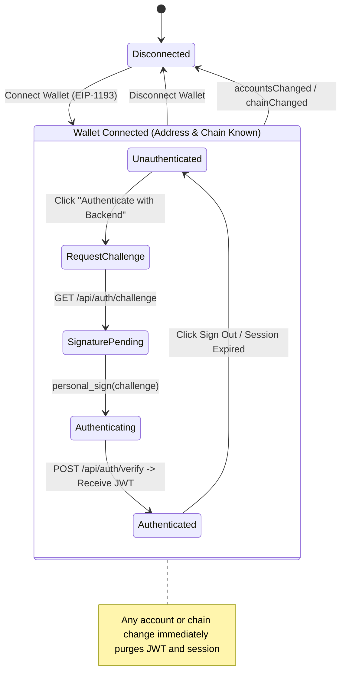

# Phase 11 — Frontend Architecture & Real Integration Documentation

## 1. Executive Summary

Phase 11 establishes the production-grade, desktop-first Next.js (App Router) user interface for the Blockchain-Based Digital Document Locker. The frontend consumes the live Phase 10 Express backend API, connects to Ethereum/EVM-compatible wallets (MetaMask) via EIP-1193, interacts with deployed smart contracts (`DocumentRegistry` and `AccessControl`), and performs cryptographic hashing using real client-side primitives.

Strict architectural principles enforced in Phase 11:
1. **Real Runtime Data Only**: Zero synthetic, mock, fake, demo, or fallback application data. Every identity, document, permission status, verification score, CID, on-chain transaction status, and audit log originates from real runtime sources.
2. **Explicit Authentication Boundary**: Wallet connection (network and account selection) and backend authentication (cryptographic challenge-signature exchange and JWT issuance) are maintained as independent state machines. Connecting a wallet does not imply backend authentication.
3. **Session Invalidation on Account/Network Mutation**: Any change to the active Ethereum address (`accountsChanged`) or network chain ID (`chainChanged`) immediately and synchronously purges the backend session, terminates the active JWT, and resets document/permission state.
4. **Zero Frontend Server Secrets**: Server secrets (`IPFS_JWT`, `IPFS_API_KEY`, `IPFS_API_SECRET`, `AUTH_JWT_SECRET`, private keys, seed phrases) are strictly forbidden from browser bundles and client environment configurations. Only public parameters (`NEXT_PUBLIC_*`) are exposed.
5. **Truthful UI State Modeling**: Empty states honestly indicate the absence of records. Error states truthfully relay dependency or authorization failures without fabricating placeholder content.

---

## 2. Directory Structure & Component Organization

The frontend codebase is organized under `frontend/` as follows:

```text
frontend/
├── app/                                 # Next.js App Router root
│   ├── layout.tsx                       # Root HTML layout with fonts & metadata
│   ├── page.tsx                         # Dashboard view (overview, metrics, feed)
│   ├── documents/
│   │   ├── page.tsx                     # Document inventory / list view
│   │   └── [id]/page.tsx                # Single document detail & provenance view
│   ├── verify/page.tsx                  # Document verification & tamper detection
│   ├── audit/page.tsx                   # Contract audit trail & chronological history
│   ├── wallet/page.tsx                  # Wallet connection & EIP-191 auth session panel
│   └── settings/page.tsx                # System readiness & contract address monitor
├── components/
│   ├── layout/
│   │   ├── Header.tsx                   # Top navigation bar, network pill, auth badge
│   │   ├── Navigation.tsx               # Main navigational links
│   │   ├── Footer.tsx                   # System build version & contract addresses
│   │   └── AppShell.tsx                 # Root layout wrapper providing AuthContext
│   ├── ui/
│   │   ├── LoadingState.tsx             # Accessible animated loading indicator
│   │   ├── EmptyState.tsx               # Honest empty state presentation
│   │   ├── ErrorState.tsx               # Honest error state with retry actions
│   │   ├── Badge.tsx                    # Semantic status badges (valid, revoked, etc.)
│   │   └── TransactionStatus.tsx        # Blockchain transaction progression tracker
│   ├── dashboard/
│   │   └── DashboardView.tsx            # Live document feed & system metrics
│   ├── documents/
│   │   ├── DocumentListView.tsx         # Tabular list of registered documents
│   │   └── DocumentDetailView.tsx       # On-chain details, permissions, CID
│   ├── verify/
│   │   └── VerifyView.tsx               # SHA-256 candidate vs on-chain verification
│   ├── audit/
│   │   └── AuditView.tsx                # Chronological blockchain event timeline
│   ├── wallet/
│   │   └── WalletView.tsx               # Unified wallet & backend session console
│   └── settings/
│   │   └── SettingsView.tsx             # Live backend health & readiness monitor
├── lib/
│   ├── api/
│   │   ├── types.ts                     # TypeScript schemas for all API payloads
│   │   └── client.ts                    # Centralized, typed ApiClient singleton
│   ├── auth/
│   │   ├── types.ts                     # AuthContext state types and interfaces
│   │   └── AuthContext.tsx              # AuthProvider and useAuth() state machine
│   ├── config/
│   │   └── env.ts                       # Public environment configuration loader
│   ├── crypto/
│   │   └── document-crypto.ts           # Phase 8 cryptographic hashing & AES
│   ├── ipfs/
│   │   └── ipfs-service.ts              # Phase 9 backend IPFS utility
│   └── wallet/
│       ├── wallet-context.tsx           # EIP-1193 wallet connector
│       └── wallet-utils.ts              # Address formatters & checksum utilities
└── tests/                               # Frontend automated test suite
    ├── api-client.test.ts               # Unit tests for ApiClient
    ├── auth-session.test.ts             # Unit tests for session lifecycle
    ├── ui-states.test.ts                # Unit tests for UI state components
    ├── integration.test.ts              # Live local integration test
    ├── wallet-identity.test.ts          # Phase 4 wallet unit tests
    ├── cryptography.test.ts             # Phase 8 crypto unit tests
    └── ipfs.test.ts                     # Phase 9 IPFS unit tests
```

---

## 3. Wallet Connection & Authentication UX

### 3.1 Separation of States
The application strictly separates wallet connection from backend authentication:



### 3.2 Authentication Flow Sequence
1. **Challenge Request**: The frontend calls `GET /api/auth/challenge?address=0x...`. The Phase 10 backend generates a cryptographically random, timestamped, single-use EIP-191 challenge string with a 5-minute TTL.
2. **Signature Request**: The frontend prompts MetaMask via `personal_sign(challenge, address)`.
3. **Signature Verification & Token Issuance**: The frontend posts `{ address, signature }` to `POST /api/auth/verify`. The backend recovers the signer address using `ethers.verifyMessage`. If identical, it issues a signed HS256 JWT containing `{ address }` with a 24-hour expiration.
4. **Session Persistence**: The frontend stores the JWT in `sessionStorage` (cleared on browser tab close) under a key scoped to the active account address (`doc_locker_jwt_0x...`).
5. **Account & Network Change Guardrails**:
   - When MetaMask emits `accountsChanged`, `AuthContext` compares the new address with the stored session address. If changed, `apiClient.clearToken()` is invoked immediately, `sessionStorage` is purged, and auth state reverts to unauthenticated.
   - When MetaMask emits `chainChanged`, the app checks if the chain matches `NEXT_PUBLIC_CHAIN_ID`. If mismatched, an alert banner blocks further transactions and clears active sessions until the user switches to the supported network.

---

## 4. API Client & Backend Integration

### 4.1 Typed ApiClient Architecture
The frontend communicates with the Phase 10 Express backend exclusively via the typed `ApiClient` singleton located in `frontend/lib/api/client.ts`.

Key features:
- **Centralized Authorization**: Automatically attaches `Authorization: Bearer <jwt>` to outgoing requests when an active token is configured.
- **Normalized Error Handling**: Converts non-2xx HTTP responses into structured `ApiError` instances containing `message`, `status`, and optional error details from the backend.
- **Fail-Safe Probing**: Provides lightweight `getHealth()` and `getReady()` probes to test connectivity to the backend, local Hardhat RPC node, and Pinata IPFS gateway.

### 4.2 Endpoints Consumed
| Method | Endpoint | Description | Auth Required |
|---|---|---|---|
| `GET` | `/api/health` | Service liveness probe | No |
| `GET` | `/api/ready` | RPC & Pinata readiness inspection | No |
| `GET` | `/api/auth/challenge` | Obtain single-use EIP-191 challenge string | No |
| `POST` | `/api/auth/verify` | Submit signature and receive JWT | No |
| `GET` | `/api/documents` | Fetch documents owned by or shared with user | **Yes** |
| `GET` | `/api/documents/:id` | Fetch specific document details & provenance | **Yes** |
| `POST` | `/api/verify` | Verify document candidate hash against contract | No |
| `GET` | `/api/audit/:documentId` | Fetch chronological on-chain event lineage | **Yes** |

---

## 5. Screen Specifications & State Models

### 5.1 Dashboard (`/`)
- **Metrics Bar**: Displays live counts of Total Documents, Active Access Grants, and System Status. All counters derive from real API responses (`GET /api/documents`). If unauthenticated, displays honest prompt to authenticate.
- **Live Document Feed**: Displays the user's registered documents with status badges (`Active`, `Revoked`, `Owner`, `Shared`).
- **Quick Actions**: Direct navigation to Document Register (Phase 12 placeholder notice), Verify Document, and Audit Trail.

### 5.2 Document Inventory (`/documents`)
- **Unauthenticated State**: Explains that backend authentication is required to query the on-chain registry for user documents.
- **Loading State**: Animated spinner with accessible text during API fetching.
- **Empty State**: Shown when the connected user has registered zero documents on-chain (`No Documents Found: Connect with an account that has registered documents, or register a new document in Phase 12`).
- **Data Table**: Columns for Document ID, Name/Hash, IPFS CID, Status, Access Type, and Actions.

### 5.3 Document Detail (`/documents/[id]`)
- **Metadata Cards**: Displays Document ID, Owner Address, IPFS CID, SHA-256 File Hash, Registration Timestamp, Revocation Flag, and User Permissions (`isOwner`, `hasAccess`).
- **Direct Links**: Links to on-chain verification view and audit trail for the selected document.
- **Error State**: Displays truthful 404 error if document does not exist on-chain or 403 error if access is denied.

### 5.4 Verification Portal (`/verify`)
- **Hash Comparison Engine**: Users can enter a Document ID and either provide a candidate SHA-256 hash or upload a file for instant client-side SHA-256 calculation using `document-crypto.ts` (`hashDocument()`).
- **Backend Verification**: Calls `POST /api/verify` with `{ documentId, candidateHash }`.
- **Result Presentation**:
  - `MATCH / VERIFIED`: Green badge, exact hash match, on-chain timestamp, verification duration in ms.
  - `MISMATCH / TAMPER DETECTED`: Red badge, highlights differences between candidate and on-chain hash.
  - `NOT FOUND`: Yellow badge, indicating document does not exist in registry.

### 5.5 Audit Trail (`/audit`)
- **Chronological Lineage**: Consumes `GET /api/audit/:documentId`.
- **Event Timeline**: Renders distinct visual cards for contract events:
  - `DocumentRegistered`: Block number, transaction hash, registrant address, IPFS CID.
  - `AccessGranted`: Grantee address, permission level.
  - `AccessRevoked`: Target address, revocation timestamp.
  - `DocumentRevoked`: Revocation transaction, revoker address.

### 5.6 Settings & Diagnostics (`/settings`)
- **System Readiness**: Calls `GET /api/ready` to verify that the Express backend can connect to both the Ethereum RPC provider and the Pinata IPFS gateway.
- **Contract Inspection**: Displays configured addresses for `DocumentRegistry` and `AccessControl` alongside active chain ID and RPC status.

---

## 6. Cryptography & IPFS Boundaries

### 6.1 Cryptographic Isolation
- File hashing for verification is executed entirely client-side using standard Web Crypto API (`crypto.subtle.digest("SHA-256")`).
- AES-256-GCM encryption/decryption routines remain client-side libraries (`document-crypto.ts`).
- Private keys and seed phrases are never accessed, handled, or stored by the application code; signing requests are delegated exclusively to MetaMask via EIP-1193.

### 6.2 IPFS Gateway Boundary
- The browser frontend contains zero Pinata API credentials.
- All IPFS uploads and retrievals are mediated by the Phase 10 backend endpoints.
- The frontend receives only authentic IPFS CIDs (CIDv1 base32) and on-chain content hashes.

---

## 7. Environment Configuration

All frontend configuration is managed via public environment variables in `frontend/.env.local`:

```bash
# Public API and Blockchain Configuration
NEXT_PUBLIC_API_BASE_URL="http://localhost:3001"
NEXT_PUBLIC_CHAIN_ID="31337"
NEXT_PUBLIC_CONTRACT_DOCUMENT_REGISTRY="0x5FbDB2315678afecb367f032d93F642f64180aa3"
NEXT_PUBLIC_CONTRACT_ACCESS_CONTROL="0xe7f1725E7734CE288F8367e1Bb143E90bb3F0512"
NEXT_PUBLIC_CONTRACT_NETWORK="localhost"
```

The config loader (`frontend/lib/config/env.ts`) validates the presence and types of these variables on startup. If any required variable is missing, the application halts with a descriptive error.

---

## 8. Accessibility & Responsiveness

- **Desktop-First Grid**: Optimized for desktop viewport resolutions (1280px+) with graceful responsive flex layouts for tablets and smaller screens.
- **WCAG 2.1 AA Compliance**: High-contrast color palette with WCAG compliant text-to-background contrast ratios (> 4.5:1 for body text, > 3:1 for large headers).
- **Semantic HTML**: Proper heading hierarchy (`h1` through `h4`), semantic elements (`nav`, `main`, `header`, `footer`, `section`, `article`), and descriptive button labels.
- **ARIA Live Regions**: Dynamic status changes, loading indicators, and error banners utilize `aria-live="polite"` or `role="alert"` for screen reader announcements.
