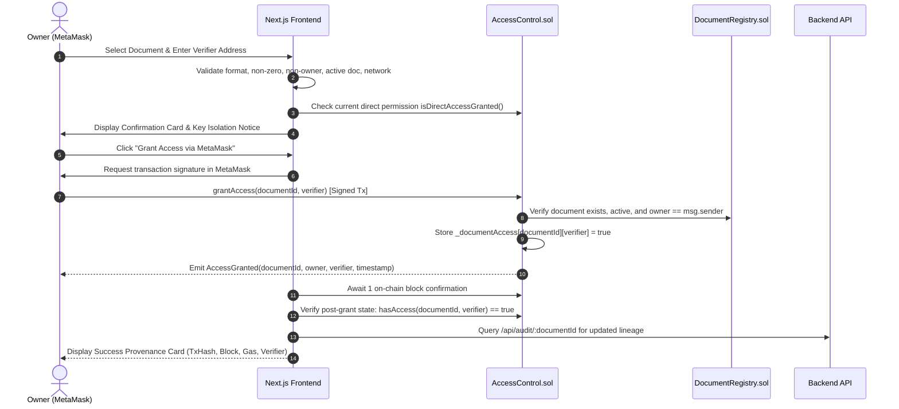
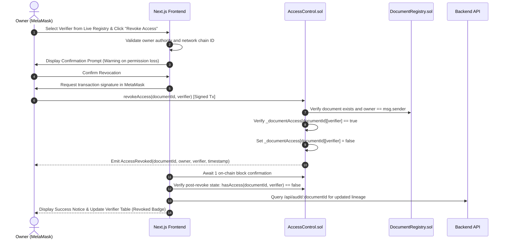

# Document Sharing & Access Revocation Architecture Specification
# Blockchain-Based Digital Document Locker

> **Document Status:** Complete (Phase 13 Baseline)  
> **Document Version:** 1.0.0  
> **Phase Target:** Phase 13 of 16 (Real Document Sharing & Access Revocation Workflow)  
> **Scope Notice:** This document establishes the complete architectural specification for on-chain document access authorization and revocation, governing the integration between MetaMask, the Next.js frontend, `AccessControl.sol`, and the read-only backend API.

---

## 1. Owner Authorization Requirements

Access control in the Digital Document Locker follows a non-custodial, sovereign ownership model:

1. **Irrevocable Ownership Binding:** When a document is registered on `DocumentRegistry.sol`, the msg.sender is irrevocably recorded as the document's `owner`.
2. **Sole Authorization Authority:** Only the document owner possesses the authority to grant or revoke verifier access. No platform administrator, backend service, or third party can authorize or revoke access on behalf of the owner.
3. **Pre-Transaction Client Check:** Before dispatching an on-chain transaction, the frontend compares the connected wallet address against `document.owner`. If mismatched, the sharing interface disables input fields and presents an unauthorized notice.
4. **On-Chain Enforcement:** The `AccessControl.sol` smart contract enforces ownership via the `onlyDocumentOwner(documentId)` modifier:
   ```solidity
   IDocumentRegistry.Document memory doc = documentRegistry.getDocument(documentId);
   if (doc.owner != msg.sender) {
       revert NotDocumentOwner(documentId, msg.sender);
   }
   ```
5. **Zero Custodial Delegation:** The backend API never holds private keys and cannot sign transactions. All permissions are minted directly by the owner's MetaMask wallet.

---

## 2. Verifier Address Input & Validation Rules

The sharing workflow enforces rigorous, client-side, fail-closed validation on target verifier addresses before any transaction request is constructed:

1. **Format Validation:** The address must be a valid 20-byte Ethereum address (`0x` followed by 40 hexadecimal characters), validated using `ethers.isAddress()`.
2. **Non-Empty Requirement:** Empty strings, whitespace-only inputs, or undefined values are immediately rejected.
3. **Zero Address Defense:** The Ethereum null address (`0x0000000000000000000000000000000000000000`) is strictly prohibited. Granting access to the zero address is rejected client-side and reverts on-chain with `InvalidVerifierAddress()`.
4. **Self-Granting Rejection:** An owner cannot grant access to their own wallet address. Attempting to share a document with the owner address triggers an explicit validation error: *"Cannot grant access to yourself: Document owner already possesses full access."*
5. **Checksum Normalization:** Valid addresses are converted to standard mixed-case checksum format (`ethers.getAddress(input.trim())`) for on-chain submission, while case-insensitive lowercase comparisons are used for state checks.

---

## 3. Step-by-Step Grant Workflow

The end-to-end grant workflow progresses through the following sequential stages:



---

## 4. Step-by-Step Revocation Workflow

The access revocation workflow terminates a verifier's on-chain permission:



---

## 5. `AccessControl.sol` Contract Interaction Details

The frontend interfaces with the deployed `AccessControl.sol` contract (deployed at `0xe7f1725E7734CE288F8367e1Bb143E90bb3F0512` on chain 31337):

### Contract ABI Methods Used
- **`grantAccess(bytes32 documentId, address verifier)`**: State-modifying function signed by owner's MetaMask wallet. Reverts with `NotDocumentOwner`, `DocumentNotFound`, `DocumentIsRevoked`, `InvalidVerifierAddress`, or `AccessAlreadyGranted`.
- **`revokeAccess(bytes32 documentId, address verifier)`**: State-modifying function signed by owner's MetaMask wallet. Reverts with `NotDocumentOwner`, `DocumentNotFound`, `InvalidVerifierAddress`, or `AccessNotGranted`.
- **`hasAccess(bytes32 documentId, address verifier) view returns (bool)`**: Composite read query that returns `true` if and only if the document exists, is not revoked on `DocumentRegistry`, and direct access is granted to the verifier (or verifier is the owner).
- **`isDirectAccessGranted(bytes32 documentId, address verifier) view returns (bool)`**: Direct permission lookup for explicit grants.

### Contract Events Consumed
- **`event AccessGranted(bytes32 indexed documentId, address indexed owner, address indexed verifier, uint256 timestamp)`**
- **`event AccessRevoked(bytes32 indexed documentId, address indexed owner, address indexed verifier, uint256 timestamp)`**

---

## 6. Workflow States & Transitions

The sharing state machine strictly manages 11 distinct operational states:

| State | Description | Next Allowed States |
|---|---|---|
| `IDLE` | Default initial state awaiting user input | `PREPARING` |
| `PREPARING` | Performing address validation and pre-flight ownership checks | `AWAITING_WALLET_APPROVAL`, `ERROR` |
| `AWAITING_WALLET_APPROVAL` | Prompting user to sign transaction in MetaMask | `TRANSACTION_PENDING`, `WALLET_REJECTED`, `ERROR` |
| `TRANSACTION_PENDING` | Transaction broadcast; waiting for 1 on-chain block confirmation | `VERIFYING_POST_STATE`, `ERROR` |
| `VERIFYING_POST_STATE` | Automated read-after-write verification on `AccessControl` | `SUCCESS`, `CONSISTENCY_MISMATCH` |
| `SUCCESS` | Transaction confirmed and on-chain state verified | `IDLE` |
| `WALLET_REJECTED` | User explicitly cancelled the transaction prompt in MetaMask | `IDLE`, `PREPARING` |
| `ERROR` | An unhandled exception or contract revert occurred | `IDLE`, `PREPARING` |
| `NETWORK_MISMATCH` | Active MetaMask chain ID differs from target (31337) | `IDLE` (once chain matches) |
| `UNAUTHORIZED` | Connected wallet is not the owner of the document | Terminal for write operations |
| `CONSISTENCY_MISMATCH` | Transaction mined, but post-state check failed | Terminal error state |

---

## 7. Post-Transaction Verification Requirements

To guard against reorgs, RPC node latency, and state mismatches, the frontend executes automated read-after-write verification immediately after block mining:

1. **Post-Grant Verification (`verifyPostGrantState`):**
   - Directly calls `AccessControl.hasAccess(documentId, verifier)` via read-only provider.
   - Asserts return value strictly equals `true`.
   - If `false`, rejects the operation and enters `CONSISTENCY_MISMATCH`.
2. **Post-Revoke Verification (`verifyPostRevokeState`):**
   - Directly calls `AccessControl.hasAccess(documentId, verifier)` via read-only provider.
   - Asserts return value strictly equals `false`.
   - If `true`, rejects the operation and enters `CONSISTENCY_MISMATCH`.
3. **Audit Trail Alignment:**
   - Queries `GET /api/audit/:documentId` to confirm the emission of the corresponding event (`AccessGranted` or `AccessRevoked`) with matching transaction hash.

---

## 8. UI State Model & Visual Feedback

The desktop-first UI provides clear, honest, and accessible feedback:

- **Pre-Transaction Summary:** Displays Document ID, Target Verifier, Ownership Status, and Action Type before requesting signature.
- **Key Isolation Notice:** Emphasizes that on-chain permission does NOT deliver the cryptographic AES decryption key.
- **Stage Indicators:** Displays honest, non-fake step transitions with real block heights and transaction hashes.
- **Provenance Card:** On success, renders the real transaction hash (with block explorer link), mined block number, gas used, and timestamp.
- **Verifier Table:** Reconstructs the complete verifier lineage from live audit logs, displaying:
  - Verifier public address
  - Grant timestamp and transaction hash
  - Status badge: `Active Access` (green) or `Access Revoked` (gray)
  - Interactive "Revoke Access" action for currently active verifiers

---

## 9. Revocation Interactions (Document-Level vs Permission-Level)

The system distinguishes between two levels of revocation:

1. **Permission-Level Revocation (`AccessControl.revokeAccess`):**
   - Revokes access for a *single specific verifier*.
   - Does not affect other granted verifiers or the document's existence.
   - Can be re-granted later if the owner decides to re-authorize that verifier.
2. **Document-Level Revocation (`DocumentRegistry.revokeDocument`):**
   - Marks the entire document as permanently revoked (`isRevoked = true`).
   - Overrides all individual verifier permissions immediately:
     $$\forall v: \text{isRevoked}(d) \implies \text{hasAccess}(d, v) = \text{false}$$
   - Prevents any new access grants: calling `grantAccess` on a revoked document reverts on-chain with `DocumentIsRevoked(bytes32)`.
   - The UI blocks granting on revoked documents and renders a prominent notice: *"This document has been permanently revoked on-chain. New access grants are forbidden."*

---

## 10. Audit Event Logging

Every authorization modification creates an immutable, indexed event log on the blockchain:

- **`AccessGranted`**:
  - `documentId` (indexed `bytes32`)
  - `owner` (indexed `address`)
  - `verifier` (indexed `address`)
  - `timestamp` (`uint256`)
- **`AccessRevoked`**:
  - `documentId` (indexed `bytes32`)
  - `owner` (indexed `address`)
  - `verifier` (indexed `address`)
  - `timestamp` (`uint256`)

The backend audit service (`/api/audit/:documentId`) reads these logs via `eth_getLogs`, sorts them chronologically by block number and log index, and presents a complete historical audit trail.

---

## 11. Account-Switch & Network-Switch Handling

The frontend actively listens for MetaMask provider events to maintain cryptographic hygiene:

1. **`accountsChanged` Event:**
   - Immediately purges active in-flight sharing transactions.
   - Clears verifier input form and resets state machine to `IDLE`.
   - Re-evaluates document ownership for the newly connected account.
   - Invalidates backend session JWT to prevent cross-account replay.
2. **`chainChanged` Event:**
   - Detects network transitions. If `chainId !== 31337`, enters `NETWORK_MISMATCH`.
   - Disables all "Grant" and "Revoke" buttons.
   - Displays an amber warning banner: *"Wrong network: Connected to chain ID X, expected chain ID 31337."*

---

## 12. Security Boundaries & Threat Mitigations

| Threat | Attack Scenario | Architectural Defense |
|---|---|---|
| **Unauthorized Grant** | Non-owner calls `grantAccess` | Reverts on-chain (`NotDocumentOwner`); rejected client-side. |
| **Unauthorized Revoke** | Stranger revokes legitimate verifier | Reverts on-chain (`NotDocumentOwner`). |
| **Invalid Verifier** | Granting to zero address or self | Reverts on-chain (`InvalidVerifierAddress`); blocked in UI. |
| **Revoked Document Abuse** | Owner grants access on revoked doc | Reverts on-chain (`DocumentIsRevoked`); blocked in UI. |
| **Double Grant** | Owner grants access twice | Reverts on-chain (`AccessAlreadyGranted`). |
| **Double Revoke** | Owner revokes non-existent access | Reverts on-chain (`AccessNotGranted`). |
| **Backend Custody Risk** | Backend compromises private keys | Zero keys held by backend; all writes signed in MetaMask. |
| **Stale State Exploits** | UI displays cached permissions | Automated read-after-write verification on live chain. |

---

## 13. Explicit AES Key Distribution Limitation Notice

> [!WARNING]
> **CRITICAL SECURITY BOUNDARY:**
> Blockchain permission (`hasAccess == true`) is strictly an on-chain authorization record. It does **NOT** constitute cryptographic document decryption.
> 
> The document ciphertext stored on IPFS is encrypted with a 256-bit symmetric AES key (`AES-256-GCM`). Granting on-chain access to a verifier authorizes the verifier to retrieve document metadata and ciphertext from the backend API, but does **NOT** transfer the symmetric decryption key.
> 
> In Phase 13:
> - The AES decryption key is NEVER sent to the backend API.
> - The AES decryption key is NEVER published to IPFS.
> - The AES decryption key is NEVER submitted to or logged on Ethereum.
> - The AES decryption key is NEVER embedded in URLs, localStorage, sessionStorage, or JWTs.
> 
> Verifiers cannot decrypt confidential documents without out-of-band key transmission or an end-to-end key distribution mechanism scheduled for future architectural phases.

---

## 14. Explicit Deferred Items (Phase 14+)

The following capabilities are deliberately excluded from Phase 13 and deferred to subsequent phases:

1. **Phase 14 — Independent Verifier Portal:** Dedicated verification dashboard allowing verifiers to view documents shared with their address, upload candidate plaintext files, and execute cryptographic verification.
2. **Asymmetric Key Exchange (ECIES / RSA-OAEP):** Encrypting the AES document key with the verifier's public key for on-chain or relay distribution.
3. **Decentralized Identity (IdentityRegistry / DIDs):** Binding human-readable identities or institutional credentials to Ethereum addresses.
4. **Public Testnet Deployment:** Deployment to Sepolia or public EVM testnets.
5. **Zero-Knowledge Proofs & AI Verification:** Advanced privacy-preserving and automated verification extensions.
