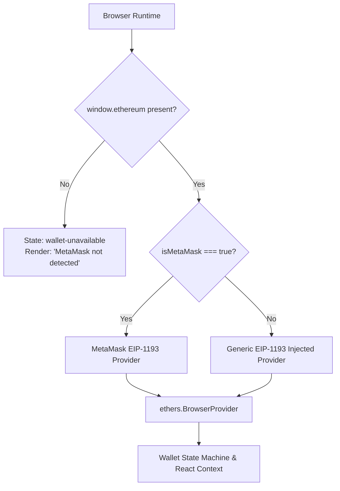

# Wallet & Identity Foundation Specification
# Blockchain-Based Digital Document Locker

> **Document Status:** Active (Phase 4 Implementation)  
> **Document Version:** 1.0.0  
> **Phase Target:** Phase 4 of 16 (Wallet & Identity Integration)  
> **Governing Standards:** `ai_rules.md` (Non-Synthetic Data Policy), `MASTER_PLAN.md`, `PHASE_4_PROMPT.md`, `docs/requirements.md`, `docs/architecture.md`, `docs/security.md`

---

## 1. Overview & Architectural Purpose

Phase 4 implements the **real wallet and identity foundation** for the Blockchain-Based Digital Document Locker. This layer connects the Next.js frontend with the user's authentic Ethereum browser wallet (MetaMask) via standard EIP-1193 provider injection (`window.ethereum`) and provides cryptographic proof-of-ownership primitives through EIP-191 personal signatures.

This foundation establishes the wallet address as the genuine identity anchor. In strict adherence to `ai_rules.md`, all identity states, addresses, chain IDs, balances, and signatures are derived from authentic runtime provider events and cryptographic verifications. No mock wallets, hardcoded demo accounts, or synthetic fallback balances exist in the runtime codebase.

---

## 2. MetaMask & Injected Provider Detection

### 2.1 EIP-1193 Provider Discovery
The frontend detects injected Web3 providers by querying the browser execution environment for `window.ethereum`:
- **MetaMask Specificity:** When `window.ethereum` is present, the provider flag `window.ethereum.isMetaMask` is checked to confirm MetaMask compatibility.
- **SSR Safety:** Because Next.js utilizes React Server Components and server-side rendering, provider access is guarded behind client-side lifecycle hooks (`useEffect` / client mounting check) to prevent `window is undefined` exceptions during server rendering.
- **Fail-Closed State:** If `window.ethereum` is absent, the wallet state transitions to `wallet-unavailable`. No fallback wallet or simulated keypair is created.

### 2.2 Provider Architecture Diagram


---

## 3. Wallet Connection Flow

Connection is strictly user-initiated. The application never silently connects or triggers unexpected popups.

### 3.1 Step-by-Step Connection Lifecycle
1. **User Action:** The user clicks the **Connect Wallet** action button in the UI.
2. **State Transition:** State updates to `connecting`. UI renders an active connection indicator.
3. **RPC Request:** The application dispatches `eth_requestAccounts` via `window.ethereum.request({ method: "eth_requestAccounts" })`.
4. **User Authorization in MetaMask:**
   - **Approval:** MetaMask returns an array of hex-encoded Ethereum addresses `[ "0x..." ]`. The application selects index `0` as the active address.
   - **Rejection (Error Code 4001):** The user cancels the connection prompt in MetaMask. The application catches the rejection, updates state to `error`, and renders:
     ```text
     Connection request rejected by user.
     ```
5. **Provider Initialization:** An `ethers.BrowserProvider` instance is wrapped around `window.ethereum` to query network state and native token balance.
6. **Network Verification:** The connected chain ID is retrieved and compared against the configured target network.
7. **State Transition:** If chain matches, state transitions to `connected`.

---

## 4. Chain Detection & Network Validation

### 4.1 Chain ID Verification
At runtime, the connected network's Chain ID is retrieved directly from the provider:
```typescript
const network = await provider.getNetwork();
const currentChainId = Number(network.chainId);
```
The application reads the expected network configuration from environment variables (`NEXT_PUBLIC_CHAIN_ID`), which defaults to `31337` for the local Hardhat development network established in Phase 3.

### 4.2 Network Validation Invariant
- **Matching Network:** If `currentChainId === expectedChainId`, wallet interaction is enabled.
- **Wrong Network:** If `currentChainId !== expectedChainId`, the state transitions to `wrong-network`.
  - Wallet-dependent actions (such as signing or future contract interactions) are disabled.
  - The UI displays an honest warning:
    ```text
    Connected to unsupported network (Chain ID: <actual>).
    Please switch MetaMask to the configured development network (Chain ID: <expected>).
    ```
- **Zero Hardcoded Runtime Network:** The application never displays "Connected to Hardhat" unless the provider confirms chain ID `31337`.

---

## 5. Account-Change Handling

MetaMask permits users to switch active accounts directly from the extension interface.

### 5.1 Real Event Listener
The application attaches an event listener to the injected provider:
```typescript
window.ethereum.on("accountsChanged", (accounts: string[]) => {
  handleAccountsChanged(accounts);
});
```

### 5.2 State Reset & Isolation Invariants
When an `accountsChanged` event fires:
1. **Empty Accounts Array (`accounts.length === 0`):** Indicates the user locked MetaMask or disconnected the site. The application immediately transitions to `disconnected` and purges all active session and address state.
2. **New Account Selected:**
   - Active address is updated to the newly selected account.
   - **Critical Security Invariant:** Any existing proof-of-ownership signature or verified identity state tied to the previous address is **instantly invalidated and cleared**.
   - A new account never inherits authentication or proof-of-ownership state from another account.
   - The UI displays a notification indicating the active account changed and prompts for re-verification if required.

---

## 6. Network-Change Handling

MetaMask emits `chainChanged` when the user switches networks.

### 6.1 Real Event Listener
```typescript
window.ethereum.on("chainChanged", (chainIdHex: string) => {
  handleChainChanged(chainIdHex);
});
```

### 6.2 Handling Logic
- The hex string (e.g., `0x7a69` for 31337) is parsed to decimal.
- Active chain ID state is updated.
- Network compatibility is re-evaluated against `expectedChainId`.
- If the new chain is unsupported, state switches to `wrong-network` and wallet actions are locked.
- If the new chain is supported, native balance is re-fetched and `connected` state is restored.

---

## 7. Real Wallet Signature & Proof-of-Ownership Foundation

To prove control over the connected wallet without transmitting private keys, Phase 4 implements an authentic user-initiated signature challenge using standard EIP-191 personal signatures (`personal_sign`).

### 7.1 Runtime Nonce Generation
To prevent replay attacks, every signature challenge utilizes a dynamically generated cryptographic nonce:
```typescript
const nonce = crypto.randomUUID(); // Or window.crypto.getRandomValues()
```
No static nonces (such as `123456`, `hello`, or `test`) are permitted.

### 7.2 Human-Readable Message Format
The user signs an explicit, transparent message detailing the purpose, address, chain ID, and timestamp:
```text
Digital Document Locker — Proof of Wallet Ownership

Wallet Address: <actual connected address>
Chain ID: <actual chain id>
Nonce: <runtime generated nonce>
Timestamp: <ISO-8601 timestamp>

Signing this message verifies control of your wallet address. This action incurs zero gas fees.
```

### 7.3 Signing Request Lifecycle
1. The user clicks **Prove Wallet Ownership**.
2. State transitions to `signing`.
3. The frontend obtains the signer via `await provider.getSigner()`.
4. The signer calls `await signer.signMessage(message)`.
5. MetaMask displays the raw text to the user for signature approval.
6. If the user approves, a 65-byte ECDSA signature string (`0x...`) is returned.
7. If the user rejects (Error Code 4001), the application catches the rejection and reports:
   ```text
   Signature request was rejected by user. No proof of wallet ownership was created.
   ```

---

## 8. Cryptographic Signature Verification

Verification must occur before declaring ownership proven.

### 8.1 Verification Algorithm
The application verifies the signature client-side using `ethers.verifyMessage`:
```typescript
const recoveredAddress = ethers.verifyMessage(message, signature);
const isValid = recoveredAddress.toLowerCase() === connectedAddress.toLowerCase();
```

### 8.2 Outcome Rules
- **Match:** `recoveredAddress.toLowerCase() === connectedAddress.toLowerCase()`
  - Proof of ownership is recorded as **VERIFIED**.
  - UI displays a verified identity badge and derived signing address.
- **Mismatch or Mutation:** If a single character of the message or signature is altered, `ethers.verifyMessage` recovers an entirely different address or throws a cryptographic decoding error.
  - Proof of ownership is recorded as **FAILED**.
  - UI renders an explicit alert: `Cryptographic verification failed. Recovered address does not match.`
  - No synthetic success is permitted.

---

## 9. Identity Model for Phase 4

### 9.1 Anchor Architecture
In Phase 4, the user's authentic Ethereum wallet address serves as the primary identity anchor:
```text
MetaMask Wallet
      ↓
Ethereum Address (0x...)
      ↓
EIP-191 Personal Signature
      ↓
Cryptographic Address Recovery (ethers.verifyMessage)
      ↓
Proof of Wallet Control Verified
```

### 9.2 Scope Clarification
- **No Premature W3C DIDs:** While the master architecture plans for `did:ethr:<address>` mappings, Phase 4 does not claim a full W3C DID implementation until the on-chain `IdentityRegistry.sol` contract is deployed and verified in Phase 5.
- **Zero Hardcoded Users:** No mock profiles ("Demo User", "Alice", "0x123...") exist in the runtime state. An unverified state is represented as an unverified empty state.

---

## 10. Deterministic Wallet State Model

The frontend enforces the following 8 mutually exclusive states:

| State Key | Meaning | User Interface Representation | Permitted Actions |
| :--- | :--- | :--- | :--- |
| `initializing` | Detecting browser environment | Skeleton loader / Spinner | None |
| `wallet-unavailable` | `window.ethereum` absent | Warning Banner: "MetaMask not detected. Please install a Web3 wallet." | Download MetaMask link |
| `disconnected` | Provider detected; no account connected | Empty State: "No wallet connected." | "Connect Wallet" button |
| `connecting` | Awaiting user approval in MetaMask | Loading indicator: "Connecting to wallet..." | Cancel |
| `connected` | Account connected & chain valid | Address, Balance, Network badge, "Prove Ownership" | Disconnect, Prove Ownership |
| `wrong-network` | Connected to unsupported chain | Alert: "Connected to unsupported network. Switch to development network." | Switch Network request |
| `account-changed` | Account switched; state invalidated | Notification: "Account switched to [Address]. Re-verification required." | Re-prove ownership |
| `error` | Rejection or provider RPC error | Fail-Closed Error Card with specific error message | Retry |

---

## 11. Security Invariants & Fail-Closed Rules

1. **Zero Secret Leakage:** Browser code never stores, generates, or accesses private keys, mnemonics, or RPC API keys. Key management is delegated entirely to the MetaMask extension.
2. **No LocalStorage Authority:** LocalStorage is never used as an authoritative source of truth for wallet ownership or authentication status.
3. **No Synthetic Fallbacks:** If balance retrieval, network retrieval, or signature recovery fails, the system outputs the exact runtime error and remains in a fail-closed unauthenticated state.
4. **Account State Isolation:** When the active wallet changes, all cached credentials and signatures from the preceding account are immediately flushed.

---

## 12. Deferral to Later Phases

The following features are intentionally out of scope for Phase 4:
- Smart contract deployment or interaction (`IdentityRegistry.sol`, `DocumentRegistry.sol`, `AccessControl.sol`) -> **Phases 5–7**
- Backend challenge-response REST API (`POST /api/auth/challenge`, `POST /api/auth/verify`) and JWT issuance -> **Phase 10**
- Decentralized storage and IPFS pinning -> **Phase 9**
- Client-side document encryption (AES-256-GCM) and hashing -> **Phase 8**
- Document upload, sharing, and revocation workflows -> **Phases 11–13**
- Public testnet deployment and hosted RPC node keys -> **Phase 14**
